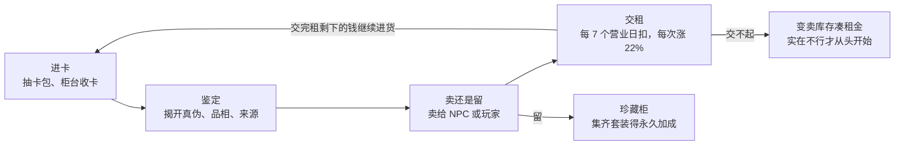

# 卡奴：游戏设计档案

> 版本 2026-11-17（加真伪鉴定和品相评级两条线；按经济模拟 `npm run sim` 定数：保守路线破产率约 15%、买店率约 70%、每周净赚中位约 1,000 金币；改成软赛季：卡和资产永久保留，赛季只是排名和发新卡的周期）。本文件是游戏规则和数值的唯一依据；怎么实现见 [SRS.md](SRS.md)。
> 所有数值都是**初版**，上线前要用模拟脚本验证（见第 9 节），改数值时同步改 `packages/shared/src/balance.ts`。

## 1. 概述

《卡奴》是一款跑在 Discord 里的卡牌经营小程序（Discord Activity）：玩家在一座反乌托邦空间站的下层区经营一间卡牌店，靠抽卡进货、鉴定真伪、卖给顾客来交每周上涨的摊位费，最终买下整间店。

**设计支柱：四股同时拉扯玩家的张力**

| 张力 | 原作《深空当铺》里的样子 | 本作里的样子 |
| --- | --- | --- |
| 时间压力 | 每周上涨的房租 | 每周上涨的摊位费，交不起就破产 |
| 信息不对称 | 货物来路不明，需要鉴定 | 卡牌有隐藏的真伪、品相、赃物属性 |
| 判断力 | 顾客需求随机，市场会波动 | NPC 顾客每天刷新，新闻事件左右卡价 |
| 风险与底线 | 走私、销赃、器官买卖 | 黑市卡包、卖赃卡、应对钓鱼执法 |

**再加一股原作没有的：收藏欲。** 集齐套装能拿到永久加成，但套装里的卡往往也最值钱，"卖还是留"是贯穿全局的核心取舍。

**平台与玩家**：Discord Activity（网页小程序），和旺财牌局一样在 Discord 里打开。面向几十到几百人的社群，每天上线 5 到 15 分钟，异步游玩，玩家之间可以交易。

**灵感来源**：《深空当铺：可能是偷的》（tinyBuild 发行）的经营循环，加上集换式卡牌的抽卡和收藏。

## 2. 核心循环

核心循环只有四步：进卡、鉴定、卖还是留、交租，然后用剩下的钱再进货。

"留"和"交不起"是两个分支：留下的卡换来收藏和永久加成，但占用了交租的钱；交不起时先变卖库存，真走到破产，珍藏柜里的卡和图鉴也都还在。

**三层节奏**

| 节奏 | 玩家做什么 | 时长 |
| --- | --- | --- |
| 营业日 | 开包、鉴定、一位一位接待 8–12 位顾客（平均 10 位），接待完打烊进入下一天（玩家自己推进，学深空当铺） | 一天几分钟，想玩几天玩几天 |
| 周循环 | 凑周日的摊位费，根据新闻决定囤货或抛售，应付巡查 | 7 天 |
| 赛季循环 | 冲赛季积分、拿赛季限定卡；赛季末不清空任何东西 | 8 周 |

## 3. 卡牌系统

每张卡分两层：**卡牌模板**（全服共用，定义这是什么卡）和**卡牌实例**（玩家手里的那一张，带隐藏属性）。同一个模板的两张卡，可能一张是完美品相的真卡，另一张是赃物。

### 3.1 卡牌模板字段

| 字段 | 说明 | 例子 |
| --- | --- | --- |
| 编号 | 系列缩写 + 序号 | NEO-017 |
| 名称 | 卡牌名 | 霓虹龙·影 |
| 系列 | 所属卡包系列，决定套装 | 霓虹纪元 |
| 稀有度 | N / R / SR / SSR / UR / LR / MR | SSR |
| 标签 | 1 到 3 个，顾客按标签提需求 | 龙、火、影 |
| 基准价 | 按稀有度给出，可单独调 | 2,200 |
| 卡面文字 | 一句世界观小故事 | "上层区禁止收藏此卡。" |

### 3.2 稀有度

| 稀有度 | 名称 | 基准价（信用点） | 每种主题包里几张 | 典藏包里几张 | 全部 5 种卡包合计 |
| --- | --- | --- | --- | --- | --- |
| N | 普通 | 25 | 7 | 4 | 32 |
| R | 稀有 | 100 | 5 | 4 | 24 |
| SR | 超稀有 | 600 | 4 | 5 | 21 |
| SSR | 特级稀有 | 2,200 | 2 | 3 | 11 |
| UR | 极稀有 | 6,000 | 1 | 2 | 6 |
| LR | 传说 | 20,000 | 1 | 1 | 5 |
| MR | 神话 | 60,000 | 0 | 1 | 1 |

2026-11-17 改：卡牌按**卡包**分，现阶段 5 种卡包（4 种主题包 + 1 种典藏包），每种 20 张卡，一共 100 张（原来是一个 53 张的系列）。每种卡包就是一个系列，见 3.5 和第 4 节。

### 3.3 卡牌实例的隐藏属性

未鉴定时界面只显示"?"。

| 属性 | 可能的值 | 影响 |
| --- | --- | --- |
| 真伪 | 真品 / 低仿 / 高仿 | 假卡卖给 NPC 会被识破，信誉下降；高仿更难识破，也更难鉴定 |
| 品相 | 1 到 10 分（另有极少数"黑标"） | 只有送评封壳后才按分数定价，见 5.2 和 9.2 |
| 来源 | 正规 / 来路不明 / 赃物 | 赃物在"失窃登记表"上有编号，被查到就没收 |
| 外层风格 | 见 3.4 | 价格 ×1 到 ×10 |

### 3.4 外层风格

同一张卡（同一个卡面图案）可以有不同的外层风格，每张实例在开包时随机决定。风格和稀有度是两条独立的轴：一张 SSR 可以是标准框，也可以是金框或编号限定。

| 风格 | 外观 | 出现概率 | 价格系数 | 限制 |
| --- | --- | --- | --- | --- |
| 标准框 | 普通卡框 | 80% | ×1 | — |
| 闪卡 | 卡框和背景带反光 | 12% | ×1.5 | — |
| 镭射碎冰 | 卡面覆一层碎冰纹镭射膜 | 5% | ×2 | — |
| 金框 | 烫金卡框，卡名镀金 | 2.5% | ×3 | — |
| 暗物质 | 黑底卡框，边缘有流动的星尘 | 0.45% | ×6 | 仅 SR 以上 |
| 编号限定 | 金属卡框，印全服序列号（如 07/50） | 0.05% | ×10 | 仅 SSR 以上；每张卡全服限量 50 张，发完即止 |

稀有度不够的卡抽到受限风格时，按标准框处理。

- **风格和稀有度相乘**：一张金框 SSR（2,200 × 3 = 6,600）在市场价上比标准框 UR（6,000）还贵，稀有风格能让低一档的卡翻身。
- **假卡也会仿风格**：高仿最常伪装成金框和暗物质。放大镜和送评都能看出来（送评只认真卡）。
- **顾客会点名要风格**：例如"要一张暗物质的龙"，这类需求预算很高。
- **图鉴分两层**：普通图鉴只看有没有这张卡；大师图鉴要每种风格各一张。
- **编号是话题**：编号限定的序列号和持有人公开可查，"01/50"这类编号可以再加溢价。
- **美术**：卡面图和外框分层。每张卡只画一次卡面，6 套外框做成可叠加的图层，由前端合成，美术量是 100 张卡面加 6 套外框，而不是 100 × 6 张图。

### 3.5 系列与套装

每种卡包就是一个系列，20 张卡。系列内再分几个 4 到 5 张的小套装（如"五龙""下层区帮派"），集齐套装解锁永久加成，见 8.1。以后每个赛季上新卡包（新系列），老卡包之后也能买到或遇到。

### 3.6 收集

卡牌**永久保留**，赛季结束不清空（2026-11-17 定）。卡可以卖给 NPC，也可以和玩家自由定价交易。收集是长期目标，分四层，越往后越难：

| 图鉴 | 怎么算集齐 | 难度参考（只靠自己开正规包，`scripts/collect-sim.ts`） | 上线阶段 |
| --- | --- | --- | --- |
| 普通图鉴 | 每张卡有过一张就点亮（卖掉也算） | 按 5 种卡包、100 张重算（待跑 `npm run sim:collect`）；旧版 53 张时整套中位约 508 包 | MVP |
| 大师图鉴 | 每张卡**可能出的**每种外层风格都有过（卖掉也算；N / R 不出暗物质和编号限定，SR 不出编号限定，这些不算） | 暗物质只在 SR 以上出、概率 0.45%，基本是长期目标 | MVP（2026-11-17 用户定提前：集齐普通图鉴不难，需要更深的收集目标） |
| 评级图鉴 | 每张卡都有一张 9 分以上的封壳卡 | 要送评、要挑卡 | 第四阶段 |
| 编号收藏 | 编号限定每张卡全服只有 50 张，"01/50"本身就是收藏品 | 看运气和交易 | 第三阶段（公开查询） |

- **图鉴页是五本册子**（一个系列一本，封面写普通 / 大师进度）。点开是浮窗，一页 3 × 3；点一张卡再开一个浮窗，看它每种卡面收集过没有、手上几张。
- 每个赛季出新系列，图鉴越来越厚，老玩家一直有东西可收。
- 赛季限定卡（S 系列）只能靠赛季排名或玩家交易拿到，见 10.5。
- 收集难度靠"加层次、出新系列"拉长，不改爆率：爆率和卡价已经按经济目标定好（9.5）。

## 4. 进卡

抽卡就是进货：玩家花信用点买卡包，买来的卡包先**原封不动**放进库存，想什么时候拆就什么时候拆。进货渠道越便宜，卡的来路就越可疑。

**5 种卡包**（现阶段，2026-11-17 定；名字是占位）

| 卡包 | 卡 | 稀有度概率 | 电脑订货价（每包 5 张） |
| --- | --- | --- | --- |
| 霓虹街头包、机械义体包、深海星港包、地下帮派包（4 种主题包） | 各 20 张，构成见 3.2 | 下表"主题包" | 300 |
| 上层区典藏包 | 20 张，唯一有 MR | 下表"典藏包" | 800（初值，待模拟） |

**进货渠道**

| 渠道 | 买什么 | 价格 | 真伪 | 限购 | 解锁条件 |
| --- | --- | --- | --- | --- | --- |
| 电脑订货（店里的终端） | 5 种卡包，按包买，**购物车**一次可以买好几种 | 正常价 | **唯一保证全是正品**、正规来源 | 每个营业日 5 包（各种合计） | 开局即有 |
| 电话批发 | 5 种卡包，**整盒买，一盒 10 包** | 每包 8 折（初值） | 批发商不保证：每张卡约 5% 是假卡（初值，低仿高仿各半） | **每个营业日只能订一次、一次一盒** | 花信用点买电话（2026-11-17 改，见 5） |
| 黑市卡包 | 黑市专供 | 200 / 包 | 每张约 25% 是假卡、20% 是赃物 | 每个营业日 3 包 | 黑市派系关系达到"熟脸"（第二阶段） |
| 柜台收卡 | NPC（卡贩）上门卖卡，摆在柜台台面客人那一侧 | 玩家自己出价 | 属性全未知，急着脱手的往往是赃物 | 科技树 G2 卡贩门路 | 第二阶段 |

- 两种订货都是**马上到货**。
- **没拆的卡包和整盒也是商品**：顾客偶尔会问"有没有整包 / 整盒的"，以后玩家之间也能交易；大部分交易还是单卡。
- 开包时先按这种卡包的稀有度概率抽稀有度，再从这种卡包里该稀有度的几张卡中随机抽一张。

**单张稀有度概率**

| 稀有度 | 主题包 | 典藏包 | 黑市卡包 |
| --- | --- | --- | --- |
| N | 64% | 52% | 52% |
| R | 24% | 27% | 27% |
| SR | 8% | 12% | 12% |
| SSR | 3.2% | 6% | 6% |
| UR | 0.6% | 2% | 2% |
| LR | 0.2% | 0.8% | 0.8% |
| MR | — | 0.2% | 0.2% |

主题包没有 MR，原来 MR 的 0.05% 并进了 LR。典藏包用黑市包那一档的爆率，但全是正品（电脑订货时）；它的价格要等模拟脚本按新卡包重跑后再定。

**定数的目标（2026-11-17）**：玩得爽，有"开卡暴富"的感觉；只走正规路线的保守玩家每周净赚约 10,000 信用点（约 1,000 金币）。换算下来：

- 正规卡包每张出 SSR 及以上约 4%，差不多每 5 包出一张；UR 及以上约 0.8%，每周开 14 包的人平均两周摸到一张。MR 一张 60,000，一个人开到就是一夜暴富，全服播报。
- 稀有度期望基准价约 254，一包 5 张的账面价值约 1,290，卡包只卖 300。**开包本身很赚，真正的瓶颈是每天只有 6 位顾客**，卡开得出来卖不完，所以"卖哪张、留哪张"仍然要动脑。
- 大部分价值集中在 UR 以上：同样是保守玩家，摸没摸到大卡，周收入能差好几倍。平均值约 10,000，中位数会低一些，以模拟脚本（9.5）跑出来的为准。

**规则**

- **保底**：主题包和典藏包（电脑订货和电话批发都算）连续 10 包没出 SSR 及以上，第 10 包必出一张 SSR。保底到 SSR 为止：UR、LR、MR 永远不进保底，只能靠真运气，或者限时活动（活动卡包、赛季奖励、全服任务奖池）拿到。保底出的 SSR 外层风格照常随机，但不会是编号限定。抽到 SSR 及以上时保底计数清零。黑市卡包没有保底。按新爆率，连开 10 包都没出 SSR 的概率约 13%，保底是兜底，不是常态。
- **每日限购**：每个营业日电脑订货最多 5 包、电话批发最多 1 盒、黑市 3 包（打烊进入下一天后重新计）。科技树和商会派系可以提高上限。
- **开包即展示**：出 UR 以上或编号限定时，通过 Bot 在频道全服播报。开包的热闹本身就是社区活跃度。
- **黑市包的帐要算清楚**：黑市包的稀有卡更多，但假卡和赃物吃掉一半利润。只有鉴定力强、敢卖赃卡的玩家才能从里面赚到钱。

### 4.5 卡册（2026-11-17 用户定）

卡要放进**卡册**才算收好。所有卡册的格数加起来就是库存上限；更贵的卡册放得更多，还有额外效果。

| 卡册 | 价格（初值） | 格数 | 效果 |
| --- | --- | --- | --- |
| 简易卡册 | 开局送 1 本，再买 200 | 27 张（3 页） | 防磨损 |
| 九宫格活页册 | 1,000 | 90 张（10 页） | 防磨损 |
| 防潮收藏册 | 4,000 | 180 张（20 页） | 防磨损；里面的卡卖给收藏家，心理价位 +5% |
| 典藏皮面册 | 15,000 | 360 张（40 页） | 防磨损；里面的卡卖给任何顾客，心理价位 +5%；每个营业日多来 1 位收藏家 |

- **自动放卡**：新开出来的卡自动放进有空位的卡册；都满了才**散放在桌面上**。买了新卡册，桌面上的散卡自动收进去（按市场价从高到低）。
- **桌面最多散放 20 张**，再满就不能拆新包，要先卖卡或买新卡册。
- **散放会磨损**：每过一个营业日，每张散放的卡有 10% 的概率品相掉 1 分（黑标掉成 10，最低 1 分）。品相是隐藏属性，玩家看不到掉没掉，要送评才知道。
- **磨损画在卡上**：按"散放了几天"画（1–2 天落灰、3–5 天划痕、6 天以上划痕加卷角）。天数是公开信息，画面不代表真实品相，所以不泄露隐藏属性。
- **整理**：库存页一本本卡册，一页 9 格像真的翻卡册。点开卡册是一个可以拖到任意位置的浮窗（道具都做成浮窗，新手手册也是），卡可以从卡册浮窗或桌面直接拖进珍藏柜、从珍藏柜拖回去。
- **任务栏（2026-11-17 用户定）**：固定在醒目位置（横屏在主画面右边一栏，收起时缩成右上角小标签；竖屏在顶栏下面），顶部三角收起 / 展开。一开始是新手指引：按顺序显示前 3 条没领奖的任务，点任务跳到对应页面，做完点"领取"拿信用点（任务和奖励见 balance.QUESTS）。科技树上线后，玩家可以在任务栏里追踪节点的解锁条件。奖励给信用点会让第一周几乎不破产；用户 2026-11-17 选"接受新手保护"，把破产压力挪到第 2–4 周（房租和买店价重调，见第 7 节）。
- **交互原则（2026-11-17 用户定，美术加进来后照这个做）**：大部分操作是**拖拽**——把东西拖到要去的地方（柜台台面、珍藏柜……），**结果用按钮确认**（开价、成交……），不会一拖就生效。道具（卡册、手册……）打开都是可以拖动的浮窗。
- **柜台台面**：台面能摆好几样（最多 8 样）。把要卖的卡从卡册浮窗 / 珍藏柜 / 桌面散放拖到柜台台面上（没拆的卡包也一样），从台面拖到别处就是拿回来。点台面上的一样选中它，再调价、按"开价 / 接受还价 / 快速出售"。台面上的东西换客人时留着，不符合新客人要求的变暗。台面上留着客人那一侧：以后客人卖卡给玩家时，他的卡也摆在台面上。
- **柜台挑卡也是翻卡册**：先列出卡册（加上桌面散放、没拆的卡包），每本标出"有几张符合这位客人"；点开一页 3 × 3，符合的高亮可点，不符合的变暗。默认"符合的排前面"（按市场价从高到低），关掉就按卡册原顺序翻，开关记在本机。
- 没拆的卡包和珍藏柜不占卡册格子。卡册在进货页的"用品"里买，不限购。
- 卡册是新的花钱去处；高级卡册的加价和加客流又会推高后期收入，两头都要进经济模拟。

## 5. 鉴定

鉴定把"?"变成具体数值，是玩家制造信息差的主要手段。不鉴定也能卖，但卖价和风险都是一场赌博。

**2026-11-17 用户重定**：鉴定只有两样东西，都是道具——

| | 放大镜（5.1） | 送评（5.2） |
| --- | --- | --- |
| 在哪 | 柜台上的道具，按住拖到卡上（学深空当铺） | 电话里的"星港评级社"；电话要花信用点买（初值 2,000） |
| 能查谁的卡 | 柜台台面上的卡（自己摆的、以后 NPC 摆的）、卡册浮窗里的卡 | 自己的卡（拖到电话上） |
| 揭示什么 | 看起来真不真、品相大概几分（相邻两档）、是不是错版 | 正式评分（1–10、四个分项、黑标），错版公开认定；假卡拒评 |
| 费用 | 免费，每张卡只查一次，结论存库不再变 | max(20, 基准价 × 风格系数 × 15%) |
| 结果 | 马上有，只有自己知道，不改卡价 | 下次打烊出，公开（封壳），按分数定价 |

原设计里的**鉴定机构**（验真证书、查失窃登记表、赃物没收）去掉了，"已验真"标记也一起去掉。赃物以后靠便衣和巡查处理（第二阶段）。

**放大镜只是自己心里有数，不改卡的价格。** 一张卡只有送评封壳之后才按分数定价，没封壳的一律按"未评级"定价（见 9.2）。这样卡的报价永远只用玩家已经知道的信息算，抵押、顾客出价都不会漏出隐藏属性。

### 5.1 放大镜

- 识破假卡：低仿 95%、高仿 60%；漏看时告诉玩家"看起来是真的"。
- 估品相：缩到相邻两档，如"8–9"（真实分随机落在上档或下档）；10 分和黑标是"10–黑标"。对假卡也照样估，估品相本身不暴露真假。
- 找错版：错版卡 80% 能认出来。
- 假卡看出来之后仍在库存里，可以低价卖给黑市中间人，或者冒险当真卡卖。
- **镜片（2026-11-18 用户定）**：拿着放大镜在卡上移动，镜片里是这张卡的卡面放大，画在指尖上方。在一张卡上停 0.3 秒就算查验（松手也算），查完镜片里按结论出现细节：看出是假的才有破绽（油墨晕开、套色错位、防伪闪光不对、边框歪），品相按估计的两档画划痕和灰尘，认出错版有重影或漏印。没查过的卡只有放大的卡面，不泄露任何东西。
- **省美术的做法**：不给每张卡画细节图。镜片 = 复用卡面放大 + 一套约 10 张通用细节贴图（所有卡共用），细节放在哪由卡的编号算固定位置（同一张卡每次看都一样）。错版重影是把卡面错开叠一次，代码做。
- **假卡识别手册**（道具浮窗，柜台上放大镜旁边的 📕）：真卡和各种破绽、品相、错版的放大对照，玩家查卡时打开对照。用同一套细节贴图拼示例，不另外画图。

**错版卡**（2026-11-17 用户定）：开包时每张卡约 0.5% 是错版（印错字、印错色），隐藏属性。放大镜能认出来；送评封壳后标签写"错版"，公开价再 ×3。没封壳的错版卡照旧按普通卡定价。

### 5.2 品相评级（送评）

**送评（星港评级社，打电话）**：max(20, 基准价 × 风格系数 × 15%)，下次打烊出正式评分并封壳。送去的卡离开卡册、不能卖，回来后放回卡册或桌面。

**图鉴不泄露真伪**：图鉴点亮只看公开信息。电脑订货保证正品，拆出来就点亮；来路不明的卡（电话批发、卡贩）送评封壳后才点亮（用户 2026-11-17 定）。

参考现实里的球星卡、宝可梦卡评级（PSA 的 1–10 分、BGS 的四项分项和"黑标"、封壳和人口报告），送评就是把一张卡变成一件"有官方分数的商品"。

**评分**：总分 1–10，同时给四个分项（居中、边角、边缘、表面）作为展示。四个分项全满 10 分的是**黑标**，比 10 分还稀有。

| 评分 | 1 | 2 | 3 | 4 | 5 | 6 | 7 | 8 | 9 | 10 | 黑标 |
| --- | --- | --- | --- | --- | --- | --- | --- | --- | --- | --- | --- |
| 出现概率 | 5% | 7% | 8% | 12% | 14% | 14% | 16% | 14% | 7% | 2.7% | 0.3% |
| 评级系数 | 0.2 | 0.3 | 0.4 | 0.5 | 0.6 | 0.7 | 0.9 | 1.2 | 2.0 | 5.0 | 15 |

- 真实品相在开包时就定好（隐藏），送评只是把它公开出来，不会再随机。
- 未评级系数是 0.85。评级系数的期望约 0.94，比 0.85 略高，所以闭着眼送评略赚但扣掉评级费基本打平；**先用放大镜筛出"9–10"（或者错版）的卡再送评**才是真正赚钱的玩法。现实玩家就是这么挑卡送评的。
- 9 分和 10 分之间差 2.5 倍，10 分和黑标之间差 3 倍：大部分价值集中在顶端。

**送评结果**

| 卡的实际情况 | 结果 |
| --- | --- |
| 真卡 | 封壳，评分和四个分项对所有人可见 |
| 假卡（低仿或高仿） | 不封壳，评级费不退，退回并打上"评级社拒评：疑似假卡"的公开标记；**信誉 −5** |
| 真卡但是赃物 | 照常封壳：评级社只看真假和品相，不查失窃登记表（待定，见下） |

- **送假卡扣信誉**：评级社会把拒评记录通报出去，不管你知不知道这张是假的。所以没用放大镜看过的卡送评，是拿信誉赌。扣多少放 balance.ts，初值 5，和卖假卡被识破一样。
- **赃物能不能封壳（待定）**：现在的写法是评级社不查赃，赃卡可以封壳卖高价，但封壳卡的编号公开，仍在失窃登记表上，巡查（8.3）照样能查出来。这给了"洗白"一条高风险的路。如果觉得太宽，可以改成评级社也查赃、查到就没收。

**封壳卡的规则**

- 封壳就说明是真卡，评分永久公开，买家（NPC 和玩家）看得到，不用再猜。
- 封壳卡不能再送评。是否允许"拆壳重评"（现实里有人拆壳赌更高分）留到第二阶段再定：如果做，评级要带一点误差，拆壳重评就成了一个吃评级费的回收口。
- **收藏家要么收 SR 以上的卡，要么收 9 分以上的封壳卡**（封壳卡不限稀有度）；居民不在乎封壳；富人买封壳卡出价更高。
- **人口报告**（第三阶段）：每张卡模板在各个分数上全服有多少张封壳卡，公开可查。"全服唯一一张黑标 UR"本身就是话题。

### 5.3 其他

- **鉴定师执照**：学会后放大镜高仿识别率升到 85%、送评费打折，还能帮其他玩家代鉴定收费（放大镜 2026-11-17 起免费，原来的"放大镜费用打折"不再适用）。
- **可选的小游戏**：后期可以把放大镜做成"找不同"小游戏（从四个卡面细节里挑出不对的那个），答对提高准确率。MVP 先用纯概率。

## 6. 柜台与 NPC 顾客

柜台是主要收入来源。每个营业日来 8–12 位 NPC 顾客（10% / 20% / 40% / 20% / 10%，平均 10 位；2026-11-17 用户定），**一位一位进门**（学深空当铺）：眼前只有一位，成交、走人或被请走之后下一位才进来；玩家不知道下一位是谁，也不知道今天还剩几位。下一位是在上一位走后才生成的，所以他想要的东西参照的是玩家当时的库存。顾客是每个玩家私人的，不用抢。今天的顾客都接待完就可以打烊，马上进入下一个营业日。

**顾客类型**（2026-11-17 扩到 9 类常规顾客；卡贩和便衣在第二阶段）

| 类型 | 出现概率 | 需求 | 心理价位系数 | 耐心 | 特点 |
| --- | --- | --- | --- | --- | --- |
| 下层区居民 | 19% | N / R，常按标签 | 0.8 | 4 | 经常只拿得出一半的钱，可以发善心打折 |
| 学生 | 10% | N / R | 0.6 | 5 | 钱少、耐心好；特殊风格（闪卡、碎冰、金框……）的卡心理价位 × 1.6 |
| 观光客 | 10% | N / R / SR | 1.1 | 3 | 上层区来的游客，不太懂行，给钱爽快 |
| 收藏家 | 12% | SR 以上的卡、9 分以上的封壳卡 | 1.2 | 2 | 看穿假卡的概率高 |
| 怀旧老顾客 | 8% | **点名要某一张卡** | 1.5 | 3 | 找到那张出价很高，别的都不要 |
| 上层区富人 | 10% | SR 以上，常按标签 | 1.4 | 3 | 很少验货，是出手假卡的最佳对象 |
| 炒卡客 | 8% | SR 以上 | 0.9 | 2 | 只肯低价收，没耐心，看穿假卡的概率不低 |
| 开箱主播 | 8% | **没拆的卡包**（可能点名某一种） | 1.3（按卡包电脑订货价） | 3 | 买回去直播开箱 |
| 黑市中间人 | 10% | 只收赃卡和未鉴定卡 | 基准价 × 40% | 3 | 唯一安全出赃卡的渠道 |
| 卡贩 | 18%（点了科技树 G2 卡贩门路才有，没点就不来；2026-11-17 用户定） | 反过来卖卡给你：每位带 1–3 张摆上柜台台面，你出价收 | — | — | 就是柜台收卡渠道（第二阶段，排在鉴定和科技树 MVP 之后：收来的卡要靠鉴定验） |
| 便衣治安员 | 2% | 伪装成任意其他类型 | — | — | 卖赃卡给他就被罚款加没收（第二阶段） |

**一次交易的流程**

1. 顾客出现在柜台：头像、一句台词、需求（如"想要火属性 SR"）、报价区间。
2. 玩家从库存里选一张符合的卡。
3. 玩家开价，顾客对比心理价位：低于心理价位直接成交；高出不多就还价，扣 1 点耐心；高出太多扣 2 点耐心。耐心归零顾客就走。
4. 成交后判定：假卡有一定概率被顾客当场看穿，退款并扣信誉；赃卡卖给便衣就触发执法。
5. 玩家也可以拒绝、或者"举报"顾客（例如对方自称有赃卡要出手），举报对了加治安关系、得奖金。

**心理价位** = 卡的市场价 × 顾客类型系数 × 随机浮动（0.85 到 1.25）。富人的类型系数是 1.4，居民是 0.8。玩家看不到这个数，只能从顾客的话和还价幅度里猜。

**信誉值**：0 到 100，开局 50。信誉高会引来更多收藏家和富人；信誉低会引来更多黑市中间人和卡贩，从而把店铺自然推向"正经店"或"销赃窝点"两条路线。

**台词是灵魂**：每类顾客至少准备 20 条台词，便衣的台词要留一点破绽（例如下层区居民却问"有没有来路特别一点的"），让细心的玩家有机会看出来。

## 7. 房租与破产

摊位费**每 7 个营业日**在打烊时扣一次（第 7、14、21……天），每次涨 22%，**涨到第 8 次封顶**；前 8 次累计大约 67,500 信用点。提前花 31,000 信用点买下店铺，就不用再交租。

第 n 周摊位费 = 3,800 × 1.22^(min(n, 8)−1)

"第几周"按玩家自己的营业日算（营业日 ÷ 7），不跟现实时间和赛季走：第 9 次以后一直按 11,921 收，直到买下店铺。

| 周数 | 1 | 2 | 3 | 4 | 5 | 6 | 7 | 8 |
| --- | --- | --- | --- | --- | --- | --- | --- | --- |
| 摊位费（信用点） | 3,800 | 4,636 | 5,656 | 6,900 | 8,418 | 10,270 | 12,530 | 15,286 |

调参记录（2026-11-17）：

- 先从每周 ×1.5 调回 ×1.25：mock 模拟（`scripts/mock/bankruptcy-sim.mjs`）显示 ×1.5 时后半季连老实交租的人都交不起，故意破产反而更赚。
- 再按正式模拟（`npm run sim`）把第一周租金从 1,000 提到 2,500：目标是保守玩家一季至少破产一次的概率约 15%。开局 1,500 不够交第一周的租，第一周必须开包卖卡。
- 2026-11-17 新手任务上线，第一周的任务奖励（平均约 1,600）让破产率掉到 0.9%。用户选"接受新手保护"：第一周租金 2,500 → 3,800、涨幅 ×1.25 → ×1.22、买店 40,000 → 31,000。模拟（每天 2 包）：破产率 14.8%（第一周只有 0.2%，大多在第 2–4 周）、买店率 69.9%、周净赚中位约 958 金币。

**租金保证金**：兑金币和换蓝图（科技树货币）都只能动**超过下次租金的那部分**信用点。交租的钱存不走，故意破产就没有好处（同一个模拟验证过）。

**买下店铺**：任何时候一次性付 31,000 就是店主（整季租金约 67,500，越早买越省；模拟里约 70% 的保守玩家能买下，中位在第 4 到 5 周）。代价是这笔钱不能拿去进货或收藏，所以是"先买店图安心"还是"先滚雪球"的取舍。买下后得到"店主"身份组，解锁扩店（更多顾客、更大库存）。

**交不起租的流程**（2026-11-17 定：先用卡抵钱，实在不行才从头开始）

1. 交租日打烊时信用点不够，就进入**欠租**：柜台不开门，不能进入下一天。
2. 欠租时玩家自己挑卡抵押给房东（按市场价的 50% 折算，没封壳的按未评级价算，7 个营业日内可以花 60% 赎回，过期归房东），或者直接卖掉，凑够就交租、继续营业。
3. 只有两种情况会**从头开始**（破产）：玩家主动申请破产，或者所有卡都抵押完了还是不够。

营业日由玩家自己推进，所以不需要现实时间的宽限期和自动抵押：不交上租，游戏就停在交租日。

**从头开始时保留与失去**

| 保留 | 失去 |
| --- | --- |
| 珍藏柜里的全部卡 | 全部信用点 |
| 图鉴进度（四层都算）和已完成套装的加成 | 珍藏柜以外的卡 |
| 科技树已点的节点和蓝图 | 店铺（已买下的也收回） |
| 赛季积分 | 派系关系减半 |

从头开始后用 1,200 信用点的启动资金重开，摊位费从第 1 周的 3,800 重新算。主动申请破产也清掉珍藏柜以外的卡，否则"交不起就申请破产、卡全留着、租金打回第一周"会变成逃租的办法。

## 8. 辅助系统

五个辅助系统各自加一种变数，按路线图逐个上线（普通图鉴和珍藏柜在 MVP，见 3.6）。

### 8.1 图鉴与套装

图鉴的四层见 3.6。套装加成要求**同时持有并放入珍藏柜**。放进珍藏柜的卡不能抵押，但可以直接在柜台卖（2026-11-17 用户定），卖掉或取出后加成随之消失。珍藏柜不占卡册格子。

**珍藏柜是店的门面（2026-11-17 用户定）**：
- 开局没有，花信用点解锁、升级（解锁 1,000 / 3 格，升级 4,000 / 5 格，再升 12,000 / 8 格；科技树 S1 再 +2 格。2026-11-17 按模拟从 2,000 / 8,000 / 25,000 下调）。破产重来时等级保留。
- **展示分**：柜里每张卡按稀有度给分（R 1、SR 3、SSR 8、UR 20、LR 50、MR 120，N 不算），再乘外层风格倍数。只看公开信息。
- **对顾客的影响**：顾客进门时按当时的展示分，每 5 分预算和心理价位 +1%（最多 +20%）；展示分 ≥ 40，每位顾客耐心 +1。快速出售价不吃加成。
- 柜里的卡有人要可以直接卖，但卖掉展示分就掉，这是取舍。
- **大藏家**：展示分 ≥ 20 时，每位进门的顾客有"展示分 × 0.01%"的几率换成大藏家（最高 1.5%）。只要 UR 以上，出价约是富人的 2 倍，耐心 2，识假很强。模拟：每天 2 包的玩家一季约 1 次，每天 5 包的约 5 次。
- 后续：其他玩家能逛你的店看珍藏柜（feat/visit-shops）；鉴定上线后，柜里放假卡有被识破扣信誉的风险。

| 套装加成例子 | 效果 |
| --- | --- |
| 五龙 | 标签为"龙"的卡，顾客心理价位 +15% |
| 下层区帮派 | 黑市卡包假卡率 −10% |
| 工匠之手 | 送评费 −30%（放大镜已免费） |
| 老店招牌 | 每天多一位顾客 |

### 8.2 新闻事件

每天 08:00（悉尼时间）发一条空间站日报，影响接下来 1 到 3 天的市场。Activity 里有日报页，Bot 同时发到频道。

- **价格波动**："霓虹纪元将重印"，该系列市场价 −30%。
- **需求风潮**："上层区兴起收藏火属性卡"，带"火"标签的顾客需求翻倍。
- **执法风声**："治安局开展专项行动"，巡查和便衣出现率翻倍。
- **假新闻**：约 15% 的新闻是谣言，消息来源标注"小道消息"。信不信由玩家判断。

### 8.3 治安巡查

每天随机抽查全服约 10% 的店铺。库存里有赃卡（不论是否鉴定过）就有 70% 概率被查出，玩家可以选：

- **交出**：没收赃卡，扣信誉 5。
- **打点**：付赃卡市场价的 60%，卡留下，但治安关系下降。
- **藏匿室**：由科技树解锁（TECH-TREE S3b、S4b），放在藏匿室（3 格，升级后 6 格）的赃卡只有 20% 概率被查出（升级后 10%）。

### 8.4 派系

三个派系，每个关系值从 −100 到 100，分为敌对 / 陌生 / 熟脸 / 盟友四档。讨好一方通常会得罪另一方。

| 派系 | 怎么加好感 | 盟友奖励 | 对立面 |
| --- | --- | --- | --- |
| 正规商会 | 卖真卡、举报赃卡 | 正规卡包 9 折、限购 +2、专属新系列先发 | 黑市 |
| 黑市 | 买黑市包、卖卡给中间人 | 失窃登记表副本（每周查 3 张卡在不在登记表上，查到不没收、不公开）、黑市专属 UR 卡包 | 正规商会、治安 |
| 收藏家协会 | 卖高品相卡给收藏家、完成套装 | 每周一次高价收卡委托 | 无，但很难刷 |

治安关系是一条隐藏数值，只影响巡查和便衣出现的频率。

### 8.6 特殊事件

2026-11-17 定：特殊事件做成**配置数据**，admin 不改代码就能加。先写在一个 JSON 文件里（重启生效），M7 做管理页时再加网页编辑。

每个事件包含：

| 字段 | 说明 |
| --- | --- |
| 触发 | 每个营业日开门时按概率掷一次；可以限定营业日范围、信誉、已点的科技树节点、现实日期（节日活动） |
| 效果 | 从固定菜单里选，见下表；一个事件可以组合几种 |
| 文案 | 事件标题、说明、相关顾客的台词 |

| 效果菜单（第一版） | 例子 |
| --- | --- |
| 多来几位顾客 | "夜市开张"：今天多来 3 位居民 |
| 来一位特殊顾客 | "上层区藏家路过"：点名要 UR 以上，心理价位 × 2 |
| 某个标签临时涨价 | "龙年祭"：带"龙"标签的卡，今天顾客心理价位 +30% |
| 卡包打折 | "批发商清仓"：电话批发今天 6 折 |
| 送东西 | "房东心情好"：送 1 包主题包 |

- 科技树负责客流和事件：柜台分支加每天的顾客数，部分节点提高事件触发概率或解锁更稀有的事件池。
- 原来电话分支里"打进来"的来电（预约客、线人、黑市来电、委托）都改成这个系统里的事件。

### 8.5 合成

5 张同系列、同稀有度的真卡合成 1 张高一档的随机卡，品相取 5 张的平均值。投入假卡会让合成失败并损失全部材料。合成消耗大量低级卡，是经济里最主要的卡牌回收口。

## 9. 经济与数值

按经济模拟（`npm run sim`，见 9.5）：只走正规路线、每天 2 包，每周交租前净赚**中位**约 9,500 信用点（约 950 金币）、**平均**约 14,700；破产率约 15%，买店率约 72%。收入很看运气：开到 UR 以上大卡的那周能多赚好几倍（P90 约 3 万）。

### 9.1 货币

只有一种游戏内货币：信用点。开局 1,500，破产重开 1,200。不设付费货币，不卖卡包。服务器金币只能从信用点单向兑出，见第 11 节。

### 9.2 市场价

市场价 = 基准价 × 品相系数 × 风格系数 × 供需系数 × 新闻系数

- 品相系数：没封壳的卡一律是**未评级系数 0.85**，不管真实品相多少、玩家自己鉴定出了什么；封壳卡按 5.2 的评级系数（0.2 到 15）。
- 风格系数：×1 到 ×10，见 3.4，期望值约 1.19。
- 供需系数：每天收市按过去 7 天的求购次数与新增流通张数对比更新，单日涨跌不超过 10%，总范围限制在 0.5 到 2.0。
- 新闻系数：没有新闻时是 1.0，受新闻影响时一般在 0.7 到 1.5 之间。

### 9.3 粗算

**一张正规卡的期望价值**：稀有度期望基准价 254 × 未评级系数 0.85 × 风格期望 1.19 ≈ 257，一包 5 张约 1,290，而卡包卖 300。开包很赚，但大部分价值集中在少数 UR 以上和稀有风格上，N 卡很难卖完。挑出高分卡送评是在这之上额外的利润。

**模拟结果**（`npm run sim`，1,000 个赛季，种子 1；只开正规包、不鉴定不送评、周五起留够租金）

| 指标 | 每天 2 包 | 每天 5 包 |
| --- | --- | --- |
| 破产率（一季至少一次） | 15.7% | 7.8% |
| 买店率 | 72.5% | 64.2% |
| 买店周数 P25 / 中位 / P75 | 第 3 / 5 / 6 周 | 第 3 / 4 / 6 周 |
| 每周交租前净赚 中位 / 平均 | 9,524 / 14,687 | 7,759 / 13,402 |
| 每周净赚 P10 / P90 | 2,768 / 29,806 | −471 / 30,380 |

瓶颈是卡：每天平均 10 位顾客，但每天开 2 包只有 10 张卡，居民只买 N / R，SR 以上靠富人和收藏家。开更多包只是多了挑选余地，卖不完，所以每天 5 包反而不如 2 包。换别的种子（2、3）结果相近：破产率 12.5%–15.7%，买店率 71%–73%，中位 950–970 金币。

调参时最管用的杠杆（同一模拟里单独试过）：让收藏家收没封壳的 SR 以上卡、提高 SR / SSR 基准价，能抬高中位收入；第一周租金决定破产率；店价决定买店率。顾客数和需求命中率也有用，但效果小一些。

### 9.4 产出与回收

| 信用点从哪里来 | 信用点去哪里 | 卡牌从哪里来 | 卡牌去哪里 |
| --- | --- | --- | --- |
| 卖卡给 NPC | 买卡包 | 正规和黑市卡包 | 卖给 NPC |
| 举报奖金 | 摊位费、买店 | 柜台收卡 | 合成消耗 |
| 收藏家委托 | 鉴定费、打点费 | 合成产出 | 没收、抵押过期 |
| | 集市 5% 手续费、罚款、兑换成金币、科技树、买店 | | 抵押过期归房东 |

经济里所有信用点都来自 NPC，玩家之间的交易只是转移。赛季不清空任何东西（软赛季），所以回收口必须够：租金、买店、科技树（整棵约 35 万）、鉴定和送评费、集市手续费，加上每周兑换金币。上线后要盯着全服信用点总量，涨得太快就加回收口或调 NPC 收购价。

### 9.5 上线前必做：模拟脚本

让"只走正规""中等风险""黑市全开"三种策略各跑 1,000 个赛季，看破产率和买下店铺的中位周数。目标（2026-11-17 定）：只走正规的保守玩家**破产率约 15%、买店率约 70%、每周交租前净赚中位约 1,000 金币**；"故意破产"策略不能比老实交租赚。现在的 `npm run sim` 只有"只走正规"一种策略，中等风险、黑市全开、送评、科技树等做到对应功能时再加。

## 10. 多人系统

多人是 Discord 版比原作多出来的一层：玩家既是同行，也是彼此的顾客和货源。

### 10.1 玩家交易（服务器担保）

1. A 在 Activity 里对 B 发起交易，选自己出的卡和信用点、想要的卡和信用点。
2. 服务器把双方物品锁住，B 收到邀请（Activity 内通知，必要时 Bot 私信）。
3. 双方都点"确认"后同时交换；任一方修改清单，确认状态重置。超过 10 分钟自动取消。

玩家之间也能卖假卡和赃卡：未鉴定的属性对买家同样显示"?"，只有封壳评分是可信的。这是欺诈的空间，也是信誉和代鉴定服务的价值所在。交易记录写进公开日志，让坑人的人留下名声。

### 10.2 集市

把卡挂到集市，定价一口价或起拍价（拍卖 24 小时）。成交收 5% 手续费，直接从经济中销毁。每人同时最多挂 5 单。

### 10.3 全服市场价

每张卡模板的市场价由基准价、新闻和全服供需共同决定，每天收市时更新（公式见 9.2）。可以查看任一张卡 7 天内的价格变化。

### 10.4 排行榜

| 榜单 | 统计内容 | 更新 |
| --- | --- | --- |
| 赛季积分榜 | 本赛季的综合积分（见 10.5），决定赛季奖励 | 实时 |
| 资产榜 | 信用点 + 已兑成金币的信用点 + 库存市场价 + 店铺（已买下按 31,000 计），累计 | 每天 |
| 图鉴榜 | 四层图鉴的进度，累计 | 实时 |
| 信誉榜 | 信誉值最高的店铺 | 每天 |
| 通缉榜 | 被查出赃卡次数最多的店铺（玩笑性质） | 每周 |

### 10.5 赛季

**软赛季**（2026-11-17 定）：一个赛季 8 周，是**排名和发新卡的周期，不清空任何东西**。信用点、卡、店铺、科技树、图鉴、派系关系都跨赛季保留。老玩家有积累是正常的，玩着开心最重要。

**赛季积分**：只算本赛季新拿到的，老玩家和新玩家在排名上起点相同。全部按里程碑给分，不按资产线性算，免得开到一张 MR 就直接拿第一。

| 来源 | 给分（初值） |
| --- | --- |
| 图鉴 | 本季每点亮一张新卡 +2；每集齐一个套装 +30；大师图鉴每完成一张卡 +20；评级图鉴每完成一张卡 +10 |
| 成就 | 每个赛季成就一次性给分，如第一次开出 UR +50、送评拿到 10 分 +40、买下店铺 +100、连续 7 天上线 +30（成就列表单独写） |
| 经营 | 本季资产首次增加 5 万 / 10 万 / 20 万，各 +30 / +60 / +100 |
| 信誉 | 赛季末信誉每 10 点 +5，最多 +50 |

同分按先达到的排前。

**赛季奖励**：赛季末按赛季积分榜发卡包，发了就能开。**每个名次都是 10 包**，名次越高，其中赛季卡包越多（2026-11-17 定）。普通卡包的系列自选（任一已上线系列的正规卡包）。

| 名次 | 赛季卡包 | 普通卡包（系列自选） |
| --- | --- | --- |
| 第 1 名 | 星冕 × 10 | — |
| 第 2 名 | 星冕 × 7 | × 3 |
| 第 3 名 | 星冕 × 5 | × 5 |
| 第 4–10 名 | 星尘 × 5 | × 5 |
| 第 11 名以后（本季积分大于 0） | 星尘 × 1 | × 9 |

每人 10 包约合 1.3 万信用点的账面价值（大约一周收入），是赛季末一次性进入经济的量，经济模拟要把它算进去。

另外按名次发 Discord 身份组和头衔（如"第一赛季·当铺大亨"）。

**赛季限定卡（S 系列）**：每个赛季 5 张，编号如 S1-1 到 S1-5，**只能靠赛季奖励或玩家交易拿到**，之后的赛季不会再出。和普通卡一样永久保留、能卖、能交易。

| 卡包 | 内容（初值） |
| --- | --- |
| 星冕卡包 | 5 张卡。每包有 50% 概率其中一张是 S 系列：S-1、S-2、S-3 各 25%，S-4 15%，S-5 10%。其余是当季系列的卡，稀有度按黑市卡包的概率表，但全是真卡、正规来源 |
| 星尘卡包 | 同上，但 S 系列只出 S-1、S-2、S-3（各三分之一），不出最稀有的两张 |

- 人人都有机会开出 S 系列卡：前 3 名的星冕卡包能出全部 5 张，其他名次的星尘卡包只出 S-1 到 S-3。最稀有的 S-4、S-5 只有前 3 名能开到，其他人只能靠玩家交易。
- 每个赛季带新系列和一两条新规则，保持新鲜感。

## 11. 金币兑换（与旺财钱包）

兑换是单向的：信用点可以换成服务器金币，金币不能换信用点。这样《卡奴》就成了服务器金币的一个新产出口，额度要和服主一起定，并登记进总经济。

| 规则 | 初版数值 |
| --- | --- |
| 汇率 | 10 信用点 = 1 金币 |
| 每人每周兑换上限 | 2,000 金币（20,000 信用点），每周一 00:00（悉尼时间）重置 |
| 兑换时机 | 随时可兑；欠租时不能兑；只能兑超过下次租金的那部分信用点（租金保证金，见第 7 节） |
| 金币 → 信用点 | 不开放 |
| 赛季末的信用点 | 不清零（软赛季），继续留着用 |

**为什么只开这一个方向**

- **不碰"花金币抽卡"**：金币买不到卡包，就不会变成拿服务器金币去赌概率。旺财开放金币买经验时，服主已经讨论过 Discord 赌博风险，这里不再多开一个口子。
- **比的是经营**：金币多的人不能拿金币买资本，大家从同一笔开局资金起步。
- **多了一个取舍**：兑多了交不起租、进不了货、点不了科技树，兑少了金币就少。
- **套现不掉名次**：资产榜把已兑出的信用点也算进去。

**量级参考**：旺财里一个活跃玩家每天签到加工资大约拿 50 到 300 金币（签到 30 起，工资 20 到 220）。只走正规路线每周交租前净赚中位约 9,500 信用点、平均约 14,700，全兑约 950 到 1,470 金币，和旺财里最活跃的人一周的签到加工资差不多。玩得再好，一个人一周最多兑 2,000 金币，这个上限是限住金币产出的唯一阀门。

预期：游戏好玩的话，玩家会把信用点花在开包、买店和科技树上，不急着兑。信用点不清零，所以不会有赛季末集中兑满的峰值。

技术接入方式见 SRS 第 6.3 节。

## 12. MVP 与路线图

MVP 只验证一件事："每天上线开卡、收集、鉴定、卖给顾客、凑租金"这个最小循环好不好玩。内测圈子 10 到 20 人，跑 4 周。

1. **第一阶段：MVP**
    - 内容：正规卡包、一个 53 张的系列、前四种外层风格、三种鉴定、前四类 NPC 顾客（不含卡贩和便衣）、房租与破产、**普通图鉴和珍藏柜**、金币兑换、管理员工具。
    - 进入下一阶段的条件：内测玩家第 2 周仍有一半以上每天上线，而且至少有人押过一次租。
2. **第二阶段：风险与抓捕**
    - 内容：黑市卡包、卡贩与柜台收卡、便衣、治安巡查、信誉值、新闻事件。
    - 条件：模拟脚本跑出的破产率和买店周数接近 9.5 的目标。
3. **第三阶段：多人**
    - 内容：担保交易、集市、全服市场价、排行榜、赛季系统（赛季积分、赛季成就、星冕 / 星尘卡包、S 系列）、编号限定公开查询。
    - 条件：一周内没有发现可以刷钱或复制卡牌的漏洞。
4. **第四阶段：深度**
    - 内容：套装加成、大师图鉴、评级图鉴、派系、合成、第二个系列、鉴定小游戏、限时活动（UR 以上除运气外的唯一来源）。

## 13. 待定问题

- [ ] 世界观是否沿用"空间站下层区"，还是换成服务器自己的设定？
- [ ] 卡面美术从哪里来：自己画、群友投稿，还是先用占位图？
- [ ] 预计活跃玩家多少？人太少时集市和全服市场价会冷清，可能需要 NPC 商人保持流动性。
- [ ] "器官贩子"一类的黑暗内容要保留到什么程度，看服务器氛围。
- [ ] 信用点换金币的汇率（10:1）和每周 2,000 金币的上限，要和服主确认。
- [x] 游戏正式名：卡奴（2026-11-14 定）
- [x] 形式：Discord Activity 网页小程序（2026-11-16 定）
- [ ] 时区：建议按悉尼时间（Australia/Sydney），和旺财钱包的"每天"口径一致，待确认。
