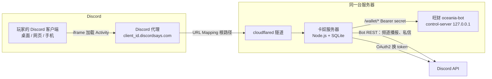

# 卡奴：软件需求规格说明（SRS）

> 版本 2026-11-17（同步 DESIGN：真伪鉴定和品相评级两条线、新数值、每周兑换上限、软赛季和卡永久保留）。游戏规则和数值以 [DESIGN.md](DESIGN.md) 为准，本文件只规定**怎么实现**。
> 需求编号形如 `FR-PACK-3`；标 **MVP** 的是第一阶段必须做的，其余按 DESIGN 第 12 节的阶段逐步实现。

## 1. 引言

### 1.1 目的

本文件给开发者（包括 Claude Code）一个可以直接动手的规格：系统由哪几部分组成、每部分要做什么、它们之间怎么通信、什么算做完。

### 1.2 范围

《卡奴》由三部分组成：

1. **卡奴 Activity**：在 Discord 里打开的网页小程序（Discord Activity），玩家所有操作都在这里完成。
2. **卡奴服务器**：Activity 的后端，持有全部游戏状态和规则，负责 Discord 登录、定时任务、频道通知。
3. **旺财钱包的一个新接口**：在现有 oceania-bot（旺财）里加 `POST /wallet/cardshop-redeem`，让信用点能兑成服务器金币。

不在范围内：旺财的其他功能、旺财牌局、付费内容。

### 1.3 术语

| 术语 | 含义 |
| --- | --- |
| Activity | Discord 的嵌入式网页应用，在 iframe 里运行，通过 Embedded App SDK 和 Discord 通信 |
| URL Mapping | Developer Portal 里的代理映射。Activity 只能访问 `https://<client_id>.discordsays.com/...`，由 Discord 代理到映射的目标地址 |
| 旺财 | 服务器现有的 oceania-bot，唯一能写金币钱包的程序 |
| 信用点 | 卡奴游戏内货币，跨赛季保留（软赛季） |
| 金币 | 服务器全局货币，存在旺财钱包 |
| 悉尼日 | 按 Australia/Sydney 时区的日历日，"每天"的统一口径 |
| 幂等 key | 每次写操作带的唯一字符串，同一个 key 重复请求只生效一次 |

### 1.4 参考

- [DESIGN.md](DESIGN.md)：游戏设计
- Discord 文档：[Activities 概览](https://docs.discord.com/developers/activities/overview)、[Building an Activity](https://docs.discord.com/developers/activities/building-an-activity)、[How Activities Work](https://docs.discord.com/developers/activities/how-activities-work)
- 官方模板：[discord/getting-started-activity](https://github.com/discord/getting-started-activity)、[embedded-app-sdk-examples / discord-activity-starter](https://github.com/discord/embedded-app-sdk-examples/tree/main/discord-activity-starter)
- oceania-bot：`src/wallet-core.js`、`src/control-server.js`（`handleWallet`）、`docs/CODE-MAP.md`
- 旺财牌局客户端仓库：已经跑通 Activity 登录、隧道部署和钱包对接，开工前先读一遍，能抄就抄

## 2. 总体描述

### 2.1 系统结构



- 玩家在 Discord 里启动 Activity，Discord 在 iframe 里加载卡奴前端。前端的所有请求都发往同源的相对路径（`/api/...`），由 Discord 代理转到卡奴服务器。
- 卡奴服务器和旺财部署在同一台机器上。旺财的 control-server 只监听 127.0.0.1，卡奴服务器用 Bearer secret 调它的 `/wallet/*`。
- Activity 自己不能在频道里发消息。开包播报、日报、催租私信都由卡奴服务器用**同一个 Discord 应用的 Bot token** 走 REST API 发送，不需要常驻 Gateway 连接。

### 2.2 用户类型

| 用户 | 能做什么 |
| --- | --- |
| 玩家 | 服务器成员，在 Activity 里玩全部内容 |
| 管理员 | 白名单里的 Discord 用户或持有指定身份组的人，可以用管理页发卡、改数值、发新闻、开关赛季、查日志 |

### 2.3 运行环境

- 客户端：Discord 桌面版、网页版、iOS、Android 里的 Activity iframe。**手机竖屏是主要场景**，最窄按 360 px 设计。
- 服务器：和旺财同一台 Linux 机器，Node.js 22，pm2 管理进程（旺财已经在用 `ecosystem.config.cjs`），cloudflared 隧道对外。

### 2.4 约束

- **C-1** 前端只能访问 URL Mapping 里配置过的地址。卡面图、字体等静态资源全部由卡奴服务器自己提供，不引用外部 CDN；确实要用外部服务时，先在 Developer Portal 加映射，并在前端调用 SDK 的 `patchUrlMappings`。
- **C-2** 金币只能由旺财写。卡奴不直接读写 `wallet.json`，只通过 `/wallet/*` 接口。
- **C-3** 所有"每天"都按悉尼日计算，和旺财钱包一致。
- **C-4** 游戏数值全部集中在 `packages/shared/src/balance.ts`，服务器、模拟脚本、前端展示共用同一份，不在别处写死。

### 2.5 假设

- 玩家已经在旺财开户（进服满 3 天自动开户）才能兑换金币；没开户的玩家可以正常玩，只是兑换时会被拒绝。
- 同时在线玩家不超过 200 人，单进程 + SQLite 足够。

## 3. 技术选型与仓库结构

| 部分 | 选型 | 理由 |
| --- | --- | --- |
| 语言 | TypeScript | 前后端和数值配置共用类型 |
| 前端 | Vite + React，`@discord/embedded-app-sdk` | 官方模板就是 Vite；React 方便做卡牌、柜台这类组件 |
| 后端 | Node.js 22 + Fastify（或 Express） | 和旺财同一个运行时，方便同一个人维护 |
| 数据库 | SQLite，用 better-sqlite3 | 同步 API，事务写起来简单，单机足够；文件好备份 |
| 测试 | Vitest | 纯逻辑单元测试 + 接口测试 |
| 部署 | pm2 + cloudflared 隧道 | 沿用旺财和旺财牌局现有的部署方式 |

```
kanu/
├── CLAUDE.md
├── docs/
│   ├── DESIGN.md
│   └── SRS.md
├── package.json            # npm workspaces
├── packages/
│   ├── shared/src/
│   │   ├── balance.ts      # 全部数值（DESIGN 里的每张表都在这里）
│   │   └── types.ts        # 前后端共用的类型、接口的请求和响应
│   ├── server/src/
│   │   ├── index.ts        # 启动、路由注册
│   │   ├── auth/           # OAuth2 换 token、会话
│   │   ├── game/           # 纯函数游戏逻辑：开包、鉴定、顾客、租金……不碰数据库和时钟
│   │   ├── db/             # 建表、迁移、查询
│   │   ├── routes/         # HTTP 接口，只做参数校验 + 调 game + 写库
│   │   ├── jobs/           # 定时任务
│   │   ├── wallet/         # 调旺财 /wallet/* 的客户端
│   │   └── notify/         # Bot REST：频道播报、私信
│   └── client/src/
│       ├── discord.ts      # SDK 初始化、登录
│       ├── api.ts          # 调 /api 的封装，自动带会话和幂等 key
│       └── pages/          # 店铺、开包、库存、柜台、兑换、管理
├── scripts/
│   └── sim.ts              # 经济模拟（DESIGN 9.5）
└── data/                   # SQLite 文件、备份（不进 git）
```

`game/` 学旺财 `wallet-core.js` 的写法：纯函数，输入当前状态、随机数源和时间，输出新状态和事件。这样单元测试和模拟脚本都能直接调用，不需要起服务器。

## 4. 功能需求

### 4.1 登录与账户（AUTH）

| 编号 | 需求 | MVP |
| --- | --- | --- |
| FR-AUTH-1 | 前端启动时调用 `discordSdk.ready()`，再用 `commands.authorize`（scope 至少 `identify`、`guilds`）拿到授权码 | MVP |
| FR-AUTH-2 | 前端把授权码发给 `POST /api/auth/token`；服务器用 client secret 向 Discord 换 access token，再用 access token 调 `GET /users/@me` 确认用户身份 | MVP |
| FR-AUTH-3 | 服务器签发自己的会话 token（HMAC 签名，24 小时有效），连同 access token 返回；前端用 access token 调 `commands.authenticate`，之后所有 `/api` 请求带 `Authorization: Bearer <会话 token>` | MVP |
| FR-AUTH-4 | 服务器**只认会话 token 里的用户 id**，不接受请求体里传来的用户 id | MVP |
| FR-AUTH-5 | 第一次登录自动建档：开局 1,500 信用点，信誉 50，摊位费从第 1 周算起 | MVP |
| FR-AUTH-6 | 只允许本服务器（`GUILD_ID`）的成员进入；别的服务器启动 Activity 时显示提示页 | MVP |
| FR-AUTH-7 | 店铺首页同时显示信用点和旺财金币余额（调 `GET /wallet/<discordId>`，失败时显示"金币暂时查不到"，不影响游戏） | MVP |

### 4.2 进卡（PACK）

| 编号 | 需求 | MVP |
| --- | --- | --- |
| FR-PACK-1 | 开正规卡包：扣 300 信用点，按 DESIGN 4 的概率表生成 5 张卡，按 3.4 随机外层风格，按 5.2 的分布随机真实品相（含黑标） | MVP |
| FR-PACK-2 | 卡牌实例的全部隐藏属性在**生成时**确定并存库，之后不再随机 | MVP |
| FR-PACK-3 | 每日限购按悉尼日计数：正规 5 包、黑市 3 包 | MVP（黑市在第二阶段） |
| FR-PACK-4 | 保底：正规卡包计数到 10 包未出 SSR 及以上时，第 10 包必出一张 SSR（风格随机但排除编号限定）；出 SSR 及以上时计数清零 | MVP |
| FR-PACK-5 | 编号限定：每个卡牌模板全服最多 50 张，序列号从 1 递增，用数据库事务保证不重号；发完后该模板不再出编号限定，改按标准框 | MVP |
| FR-PACK-6 | 开包结果有翻牌动画；出 UR 及以上或编号限定时，通过 Bot 在播报频道发一条消息（玩家名、卡名、稀有度、风格） | MVP |
| FR-PACK-7 | 黑市卡包：扣 200，按黑市概率表生成，每张独立判定 25% 假卡、20% 赃物；需要黑市派系"熟脸" | 第二阶段 |
| FR-PACK-8 | 柜台收卡：卡贩顾客出售单张卡，玩家出价，成交价由卡贩的心理价位判定 | 第二阶段 |
| FR-PACK-9 | 所有随机数在服务器用 `crypto.randomInt` 生成，前端不参与 | MVP |

### 4.3 库存（INV）

| 编号 | 需求 | MVP |
| --- | --- | --- |
| FR-INV-1 | 库存页分页显示自己的卡，可按稀有度、系列、标签、鉴定状态、是否封壳筛选 | MVP |
| FR-INV-2 | 每张卡**只显示玩家已经知道的信息**：未鉴定的属性显示"?"；服务器响应里也不能带未揭示的真实值 | MVP |
| FR-INV-3 | 卡牌图片 = 卡面图 + 外层风格图层，前端叠加显示 | MVP |
| FR-INV-4 | 卡的位置字段：库存 / 珍藏柜 / 藏匿室 / 抵押中 / 挂单中 / 交易锁定，不同位置决定能做什么操作 | MVP（前两项） |
| FR-INV-5 | 普通图鉴：每张卡模板有过一张真卡就点亮（卖掉也算），按系列显示进度；卡和图鉴永久保留，赛季结束不清空（DESIGN 3.6） | MVP |
| FR-INV-6 | 珍藏柜：默认 3 格（科技树可扩），放进去的卡不能卖、不能抵押，从头开始时保留（DESIGN 7） | MVP |

### 4.4 鉴定（APPR）

| 编号 | 需求 | MVP |
| --- | --- | --- |
| FR-APPR-1 | 鉴定分两条独立的线（DESIGN 5）：真伪鉴定（肉眼、放大镜、鉴定机构）和品相评级（肉眼估、放大镜估、送评）。每张卡每条线的每种方式**最多做一次**，结果存库，之后一直显示同一个结果（防止反复鉴定刷出真相）；一条线的结果不能泄露另一条线的属性 | MVP |
| FR-APPR-2 | 放大镜看真伪对高仿有 40% 概率漏看，漏看时告诉玩家"看起来是真的"，这个结论也存库 | MVP |
| FR-APPR-3 | 鉴定机构：扣费后卡进入"鉴定中"（不能卖、不能交易），24 小时后由定时任务出结果：真卡获得公开的"已验真"标记，假卡告知玩家（标记只玩家自己可见），赃物没收；发站内通知 | MVP |
| FR-APPR-4 | 送评：扣费后卡进入"送评中"，24 小时后出结果：真卡封壳（评分、四个分项公开）；假卡拒评退回、打公开的"拒评"标记、扣信誉（数值在 balance.ts）；赃物是否没收按 DESIGN 5.2 的待定项实现，先做成 balance.ts 里的开关。封壳卡不能再送评 | MVP |
| FR-APPR-5 | 卡的所有报价（库存显示、抵押、顾客心理价位）只用公开信息算：没封壳的一律按未评级系数，**不读真实品相**；要有测试断言两张真实品相不同的未封壳卡报价相同 | MVP |

### 4.5 柜台（CTR）

| 编号 | 需求 | MVP |
| --- | --- | --- |
| FR-CTR-1 | 每天分三个时段（悉尼 08:00、13:00、19:00 起），每个时段 2 位顾客。顾客在玩家**打开柜台时按需生成**，不靠定时任务预生成 | MVP |
| FR-CTR-2 | 没接待的顾客保留到当天结束，跨天作废 | MVP |
| FR-CTR-3 | 顾客生成时就确定类型、需求、心理价位（隐藏）、耐心值；按 DESIGN 6 的概率抽类型 | MVP |
| FR-CTR-4 | 出价流程按 DESIGN 6 的五步实现；"高出不多"和"高出太多"的阈值放 balance.ts | MVP |
| FR-CTR-5 | 成交后对假卡做识破判定，识破则退款、卡退回、扣信誉 | MVP |
| FR-CTR-6 | 便衣、举报、卖赃卡被抓 | 第二阶段 |
| FR-CTR-7 | 顾客台词从台词表随机抽取，台词表是可编辑的 JSON 文件 | MVP |

### 4.6 房租、破产、买店（RENT）

| 编号 | 需求 | MVP |
| --- | --- | --- |
| FR-RENT-1 | 每周日悉尼 20:00 扣摊位费，金额按 DESIGN 7 的公式（第 8 周封顶），周数按每个玩家自己的"第几周"算，不跟赛季走（从头开始后从 1 重算） | MVP |
| FR-RENT-2 | 余额不足进入 24 小时宽限期：Bot 私信提醒（私信失败就只在 Activity 里提示），宽限期内可以自己挑卡抵押或卖掉 | MVP |
| FR-RENT-3 | 抵押按市场价 50% 折算（未封壳按未评级价，见 FR-APPR-5），7 天内可以按 60% 赎回，过期由定时任务转给房东（删除） | MVP |
| FR-RENT-4 | 宽限期结束仍不足：系统自动抵押，从市场价最低的卡开始，珍藏柜最后动，凑够就停（一个事务里完成，写 events_log）。所有卡都抵押完还不够、或玩家主动申请破产，才从头开始：按 DESIGN 7 的表保留和清空，用 1,200 信用点重开 | MVP |
| FR-RENT-5 | 任何时候可以花 40,000 买下店铺，之后不再扣摊位费 | MVP |
| FR-RENT-6 | 首页显示下次扣租的时间和金额 | MVP |

### 4.7 金币兑换（EXCH）

| 编号 | 需求 | MVP |
| --- | --- | --- |
| FR-EXCH-1 | 兑换页显示汇率、本周剩余额度（含下次重置时间）、要扣的信用点，玩家确认后才兑 | MVP |
| FR-EXCH-2 | 只能信用点 → 金币；汇率和每周上限按 DESIGN 11；"一周"从悉尼时间周一 00:00 起算 | MVP |
| FR-EXCH-3 | 宽限期内不能兑换；兑换只能动超过下次租金的那部分信用点（租金保证金，DESIGN 7），换蓝图同理 | MVP |
| FR-EXCH-4 | 兑换流程按 6.3 节实现，保证不会"扣了信用点没到账"，也不会"两边都拿到" | MVP |
| FR-EXCH-5 | 资产榜把累计已兑出的信用点计入 | 第三阶段 |

### 4.8 管理（ADMIN）

| 编号 | 需求 | MVP |
| --- | --- | --- |
| FR-ADMIN-1 | 管理员身份由 `ADMIN_USER_IDS` 或 `ADMIN_ROLE_ID` 判定，管理页对其他人不可见、接口返回 403 | MVP |
| FR-ADMIN-2 | 给玩家发信用点或指定卡（带原因，写日志） | MVP |
| FR-ADMIN-3 | 查玩家：信用点、库存（含真实隐藏属性）、最近 100 条日志 | MVP |
| FR-ADMIN-4 | 导入和更新卡牌模板（从 JSON 文件） | MVP |
| FR-ADMIN-5 | 开启、结束赛季；内测时可以把一周缩短成 1 天，方便快速测试 | MVP |
| FR-ADMIN-6 | 手动发布新闻 | 第二阶段 |
| FR-ADMIN-7 | 查看兑换单，手动重试或关闭卡住的单子 | MVP |

### 4.9 通知（NOTIFY）

| 编号 | 需求 | MVP |
| --- | --- | --- |
| FR-NOTIFY-1 | 播报频道：出 UR 及以上、编号限定、有人买下店铺 | MVP |
| FR-NOTIFY-2 | 私信：催租、宽限期最后 2 小时、破产、鉴定和送评结果；私信失败不重试，在 Activity 里补提示 | MVP |
| FR-NOTIFY-3 | 播报有节流：同一频道每分钟最多 5 条，多了合并成一条 | MVP |
| FR-NOTIFY-4 | 每日 08:00 空间站日报 | 第二阶段 |

### 4.10 后续阶段（只列范围，开工前再细化）

- 第二阶段：黑市卡包、卡贩、便衣与举报、治安巡查、藏匿室、信誉对顾客分布的影响、新闻事件。
- 第三阶段：担保交易、集市（一口价和拍卖）、全服市场价、排行榜、赛季系统（赛季积分、赛季成就、星冕 / 星尘卡包、S 系列限定卡）和身份组发放（需要 Bot 有管理身份组权限）。
- 第四阶段：图鉴与套装加成、派系、合成、执照、第二个系列、鉴定小游戏、限时活动。

## 5. 数据需求

MVP 需要的表（字段为主要字段，类型和索引在实现时定）：

| 表 | 主要字段 |
| --- | --- |
| players | discord_id（主键）、display_name、avatar、credits、reputation、week_no、grace_until、shop_owned、pity_count、bankrupt_count、created_at |
| daily_usage | discord_id、sydney_day、packs_normal、packs_black |
| weekly_usage | discord_id、sydney_week（该周周一的日期）、coins_exchanged |
| card_templates | id（如 NEO-017）、name、series、rarity、tags（JSON）、base_price、flavor_text、image |
| card_instances | id、template_id、owner_id、authenticity（real / low_fake / high_fake）、condition（1–10，隐藏）、black_label、subgrades（JSON，送评时生成）、certified（已验真）、graded（是否封壳）、grade_rejected（被评级社拒评）、origin（legit / unknown / stolen）、style、serial_no、location、created_at |
| appraisals | instance_id、track（auth / grade）、method（eye / loupe / lab）、result（JSON，玩家被告知的结论）、status、done_at |
| serials | template_id、next_serial |
| customers | id、owner_id、sydney_day、slot、type、demand（JSON）、mind_price、patience、undercover、status |
| pawns | instance_id、owner_id、loan、redeem_price、expires_at |
| exchanges | id、key、discord_id、credits、coins、status（pending / done / failed）、attempts、last_error、created_at、updated_at |
| seasons | id、starts_at、ends_at、status、week_length_ms |
| idempotency | key、discord_id、response（JSON）、created_at（保留 48 小时） |
| job_runs | job、run_key（如 `rent:2026-11-22`）、ran_at；同一个 run_key 只执行一次 |
| events_log | id、at、discord_id、kind、data（JSON） |

要求：

- **DR-1** 所有涉及信用点或卡牌变动的操作在一个数据库事务里完成。
- **DR-2** 每次信用点变动都写一条 events_log（金额、原因、余额），出了问题能对账。
- **DR-3** 每天自动备份 SQLite 文件，保留 14 天。

## 6. 接口需求

### 6.1 前端 ↔ 卡奴服务器

全部走 `/api`，JSON 格式。写操作都要带请求头 `Idempotency-Key`（前端每次点击生成一个 UUID），服务器在 idempotency 表里查到同一个 key 就直接返回上次的结果。

| 方法 | 路径 | 作用 | MVP |
| --- | --- | --- | --- |
| POST | /api/auth/token | 用授权码换 token 和会话 | MVP |
| GET | /api/me | 玩家状态：信用点、金币余额、周数、下次扣租、保底计数、今日剩余限购、本周剩余兑换额度 | MVP |
| POST | /api/packs/open | `{ packType }` 开包，返回 5 张卡（只含已知信息） | MVP |
| GET | /api/inventory | 分页和筛选参数（`rarity`、`location`、`page`），返回库存 | MVP |
| POST | /api/inventory/:id/showcase | `{ on }` 放进 / 取出珍藏柜（设成目标状态，天然幂等，不要求幂等 key） | MVP |
| GET | /api/collection | 普通图鉴：每个系列的点亮进度、每张卡有没有过、现在有几张 | MVP |
| POST | /api/appraise | `{ instanceId, track, method }`，track 是 `auth`（真伪）或 `grade`（品相） | MVP |
| GET | /api/counter | 当前时段的顾客 | MVP |
| POST | /api/counter/:id/offer | `{ instanceId, price }`，返回成交、还价或离开 | MVP |
| POST | /api/counter/:id/dismiss | 请顾客离开 | MVP |
| POST | /api/rent/pawn | `{ instanceIds }` 抵押 | MVP |
| POST | /api/rent/redeem | `{ instanceId }` 赎回 | MVP |
| POST | /api/shop/buy | 买下店铺 | MVP |
| POST | /api/exchange | `{ coins }` 兑换金币 | MVP |
| GET | /api/exchange | 自己的兑换记录 | MVP |
| * | /api/admin/* | 管理接口 | MVP |

错误统一返回 `{ ok: false, code, message }`，`message` 是给玩家看的中文。

### 6.2 卡奴服务器 ↔ Discord

- OAuth2：`POST https://discord.com/api/oauth2/token`（authorization_code）、`GET https://discord.com/api/users/@me`。
- 成员校验：用 access token 的 `guilds` scope，或用 Bot token 查 `GET /guilds/{GUILD_ID}/members/{user_id}`（后者同时能拿到身份组，判断管理员更方便）。
- 发消息：Bot token 调 `POST /channels/{id}/messages`；私信先 `POST /users/@me/channels` 拿到 DM 频道。

### 6.3 卡奴服务器 ↔ 旺财钱包

**旺财侧要做的改动**（在 oceania-bot 仓库里，单独提交）：

1. `src/wallet-core.js`：在 `WALLET` 里加 `cardshop: { rate: 10, weeklyCap: 2000 }`；新增 `cardshopRedeem(s, { key, uid, coins, week, now })`，`week` 由调用方传悉尼时间该周周一的日期（和 `day` 一样是 `YYYY-MM-DD`）：
    - 用现有的 `once(s, key, now, fn)` 做幂等；
    - 未开户返回 `{ ok: false, error: '还没开户（进服满 3 天自动开户）' }`；
    - `coins` 必须是正整数；本周累计加这次超过 `weeklyCap` 就拒绝。周累计不能放 `s.daily`（`rollDay` 每天会清空），要单独一张表，比如 `s.cardshop[uid] = { week, coins }`，并加进 `normalizeWalletState` 的字段清单；
    - 用 `credit(s, uid, coins, 'cardshop', null, now, ledger)` 入账，返回 `{ ok: true, coins, bal, ledger }`。
2. `src/index.js` 的 `walletApi` 加 `cardshopRedeem({ key, userId, coins })`：调内核、写流水、存盘，参照现有 `prop` 的写法。
3. `src/control-server.js` 的 `routes` 加 `'/wallet/cardshop-redeem': api.cardshopRedeem`，并在文件头注释的接口清单里补一行。
4. `scripts/wallet-drill.mjs` 补用例：同一个 key 只入账一次、超额拒绝、未开户拒绝、非正整数拒绝。
5. 在总经济文档里登记这个新的金币产出口。

**卡奴侧的调用**

```
POST http://127.0.0.1:${WANGCAI_CONTROL_PORT}/wallet/cardshop-redeem
Authorization: Bearer ${WANGCAI_CONTROL_SECRET}
{ "key": "cardshop:<兑换单 id>", "userId": "<discord id>", "coins": 50 }
```

**兑换流程（FR-EXCH-4）**

1. 在一个事务里：检查额度和宽限期 → 扣信用点 → 插入 exchanges 记录（status = pending）。
2. 调旺财接口。
3. 返回 `ok: true`（包括 `replay: true`）→ 标记 done。
4. 返回 `ok: false`（明确拒绝）→ 在一个事务里退回信用点，标记 failed，把旺财的错误原因展示给玩家。
5. 超时、连接失败、HTTP 401 / 404 / 5xx（旺财对业务错误一律回 HTTP 200 + `ok: false`；503 表示钱包没开，404 说明旺财还没上这个接口）→ 保持 pending，不退信用点。定时任务每 10 分钟用**同一个 key** 重试所有 pending 单子。旺财的 `once()` 连拒绝结果也会记住，所以同一个 key 重试拿到的结论不会变。
6. pending 超过 24 小时，在管理员频道报警并停止自动重试，由管理员处理。因为旺财只记得幂等 key 48 小时，人工处理必须在这之前完成。

**余额查询**：`GET /wallet/<discordId>`，只读，用于首页显示。

> 以上按 2026-11 版旺财代码核对过：`handleWallet` 对业务结果回 200，`walletApi` 的每个写方法先 `walletEnsure`（够格就顺手开户）再调内核，最后 `walletFinish` 写流水和存盘。新接口照 `prop` 的三行写法即可。

### 6.4 跨仓库协作

卡奴和旺财是两个仓库、两个进程，只通过运行时的 HTTP 接口交互，代码上互不依赖。

- **不 import 旺财的代码**：不用 npm 依赖、git submodule 或复制 `wallet-core.js` 的方式引入。旺财的钱包状态在旺财进程的内存和 `data/wallet.json` 里，卡奴拿到函数也改不了真账，自己改只会把账弄乱。卡奴侧只写一个调 `/wallet/*` 的小客户端（`packages/server/src/wallet/`）。
- **本地开发目录**：两个仓库放在同一个父目录下，用 Claude Code 时一起打开：
    ```
    ~/projects/
    ├── oceania-bot/   # 旺财，github.com/BobZhu99/oceania-bot
    └── kanu/          # 卡奴
    ```
    改旺财的部分提交到 oceania-bot，改卡奴的部分提交到 kanu，不要混在一个提交里。
- **权限**：oceania-bot 属于 BobZhu99。旺财侧的改动（6.3 的 1–5 条）以 Pull Request 提交，由他审核合并；改完必须跑 `npm run check`（包含 `wallet-drill` 和 `wallet-flow-drill`）。
- **上线顺序**：先部署旺财的 `/wallet/cardshop-redeem`，再开放卡奴的兑换功能。顺序反了也不会丢钱：卡奴调用会拿到 404，兑换单保持 pending，旺财上线后由重试任务自动补到账，只是会延迟。
- **本地联调**：旺财的 `scripts/wallet-flow-drill.mjs --serve` 可以起一个真的 control-server 给外部程序联调（旺财牌局就是这么用的），卡奴开发兑换功能时用它，不要连生产钱包。

## 7. 定时任务

服务器进程内的调度器每分钟检查一次，按悉尼时间判断要不要执行；每个任务带 `run_key` 写进 job_runs，重启后会补跑漏掉的，但不会重复执行。

| 时间（悉尼） | 任务 | MVP |
| --- | --- | --- |
| 每周日 20:00 | 扣摊位费，进入宽限期的发私信 | MVP |
| 每 10 分钟 | 宽限期到期的自动抵押或从头开始；抵押到期的转给房东；兑换单重试 | MVP |
| 每小时 | 鉴定机构和送评到期的出结果 | MVP |
| 每天 03:00 | 备份数据库；清理 48 小时前的幂等记录 | MVP |
| 每天 08:00 | 新闻 | 第二阶段 |
| 每天 23:59 | 市场价收市 | 第三阶段 |
| 赛季末 | 按赛季积分发星冕 / 星尘卡包和身份组；不清空任何数据 | 第三阶段 |

## 8. 非功能需求

### 8.1 安全与防作弊

- **NFR-SEC-1** 服务器权威：所有规则判断、随机数、价格计算都在服务器做，前端只负责显示和发请求。
- **NFR-SEC-2** 隐藏属性（真伪、真实品相、来源、心理价位、便衣身份）永远不出现在给玩家的响应里，包括错误信息和调试字段。
- **NFR-SEC-3** 密钥（client secret、bot token、会话密钥、旺财 secret）只放服务器 `.env`，不进 git，不发给前端。
- **NFR-SEC-4** 每个玩家的写接口限流：每秒最多 5 次，超过返回 429。
- **NFR-SEC-5** 所有写接口必须带幂等 key，防止连点和网络重试造成重复扣款或重复发卡。

### 8.2 性能

- **NFR-PERF-1** 接口 p95 延迟小于 300 ms（不含调旺财的兑换接口）。
- **NFR-PERF-2** 手机上从点开 Activity 到看到店铺首页小于 3 秒；卡面图用 WebP，单张不超过 150 KB。

### 8.3 可用性

- **NFR-UX-1** 界面全中文。
- **NFR-UX-2** 手机竖屏 360 px 宽也能完整操作，按钮不小于 44 px。
- **NFR-UX-3** 每个会扣信用点的操作都显示要扣多少，并要求确认（开包除外，开包按钮上直接写价格）。

### 8.4 可维护性

- **NFR-MAINT-1** `game/` 里的纯逻辑单元测试覆盖率不低于 80%。
- **NFR-MAINT-2** 改了 `balance.ts` 必须重跑模拟脚本，把结果贴进提交说明。
- **NFR-MAINT-3** 和旺财一样，一键关闭开关：`KANU_DISABLED=1` 时所有写接口返回 503，Activity 显示维护中。

### 8.5 设计档案没给、需要在 balance.ts 里先填的数

以下数值 DESIGN 没有明确规定，先按建议值实现，内测后再调：

| 数值 | 建议初值 |
| --- | --- |
| 顾客识破假卡的概率（低仿 / 高仿） | 居民 30% / 10%，收藏家 80% / 50%，富人 10% / 5% |
| 还价阈值 | 开价 ≤ 心理价位 × 1.15 算"高出不多"，以上算"太多" |
| 顾客耐心值 | 居民 4，收藏家 2，富人 3 |
| 卖假卡被识破扣的信誉 | 5 |
| 假卡送评被拒扣的信誉 | 5 |
| 卖赃卡给便衣的罚款 | 卡的市场价 × 100%，并没收 |
| 顾客需求生成规则 | 居民从 N/R 里按标签出需求；收藏家从玩家图鉴缺口或随机 SSR 以上出需求 |

## 9. 开发顺序与验收

| 里程碑 | 内容 | 做完的标准 |
| --- | --- | --- |
| M0 跑通 | Developer Portal 建应用、开 Activities、配 URL Mapping；仓库脚手架；登录；首页显示"你好，<名字>"、信用点和旺财金币余额 | 在服务器的语音频道里启动 Activity，桌面和手机都能看到自己的名字和金币余额 |
| M1 数值 | `balance.ts` 写全 DESIGN 的表；`game/` 里实现开包、品相、风格的纯函数；`sim.ts` 能跑"只走正规"策略 | 模拟 1,000 个赛季，输出破产率和买店周数分布 |
| M2 开包与库存 | 卡牌模板导入、开包、保底、编号限定、库存页、开包播报 | 开 100 包，统计的稀有度分布在概率表误差范围内；隐藏属性不出现在任何响应里 |
| M3 鉴定 | 真伪鉴定和品相评级两条线、鉴定机构和送评的定时任务、封壳 | 同一张卡重复鉴定拿到相同结果；赃物送鉴定机构被没收；假卡送评扣信誉；未封壳卡的报价和真实品相无关 |
| M4 柜台 | 顾客生成、出价、还价、识破 | 一天能完整接待 6 位顾客；跨天作废 |
| M5 房租 | 扣租、宽限期、抵押、破产、买店 | 管理员把一周缩成 1 天，能完整走完一次破产和一次买店 |
| M6 兑换 | 旺财侧接口 + 卡奴侧兑换流程 | 断开旺财时兑换保持 pending，恢复后自动到账且只到一次 |
| M7 内测 | 管理页、日志、备份、限流、维护开关 | 10 到 20 人内测跑 4 周 |

## 10. 环境变量

| 变量 | 用途 |
| --- | --- |
| `DISCORD_CLIENT_ID` | 应用 id（前端构建时也要，用 `VITE_DISCORD_CLIENT_ID` 暴露） |
| `DISCORD_CLIENT_SECRET` | OAuth2 换 token，只在服务器 |
| `DISCORD_BOT_TOKEN` | 发播报和私信、查成员身份组 |
| `GUILD_ID` | 只允许这个服务器的成员 |
| `ANNOUNCE_CHANNEL_ID` | 开包播报频道 |
| `ADMIN_ALERT_CHANNEL_ID` | 兑换卡单等报警 |
| `ADMIN_USER_IDS` / `ADMIN_ROLE_ID` | 管理员 |
| `PORT` | 服务器端口（隧道指向它） |
| `SESSION_SECRET` | 会话 token 签名 |
| `WANGCAI_CONTROL_PORT` / `WANGCAI_CONTROL_SECRET` | 调旺财 `/wallet/*`，和旺财的 `CONTROL_PORT` / `CONTROL_SECRET` 一致 |
| `DB_PATH` | SQLite 文件路径 |
| `KANU_DISABLED` | 维护开关 |

## 11. 待定

- 生产域名：建议沿用旺财牌局的隧道，加一条路由（如 `kanu.<现有域名>`），URL Mapping 根路径指向它。需要管隧道的人确认。
- 用新的 Discord 应用还是复用旺财牌局的应用：建议**新建**一个"卡奴"应用，Activity 列表里显示独立的名字和图标。
- 时区按悉尼时间：待确认（见 DESIGN 13）。
