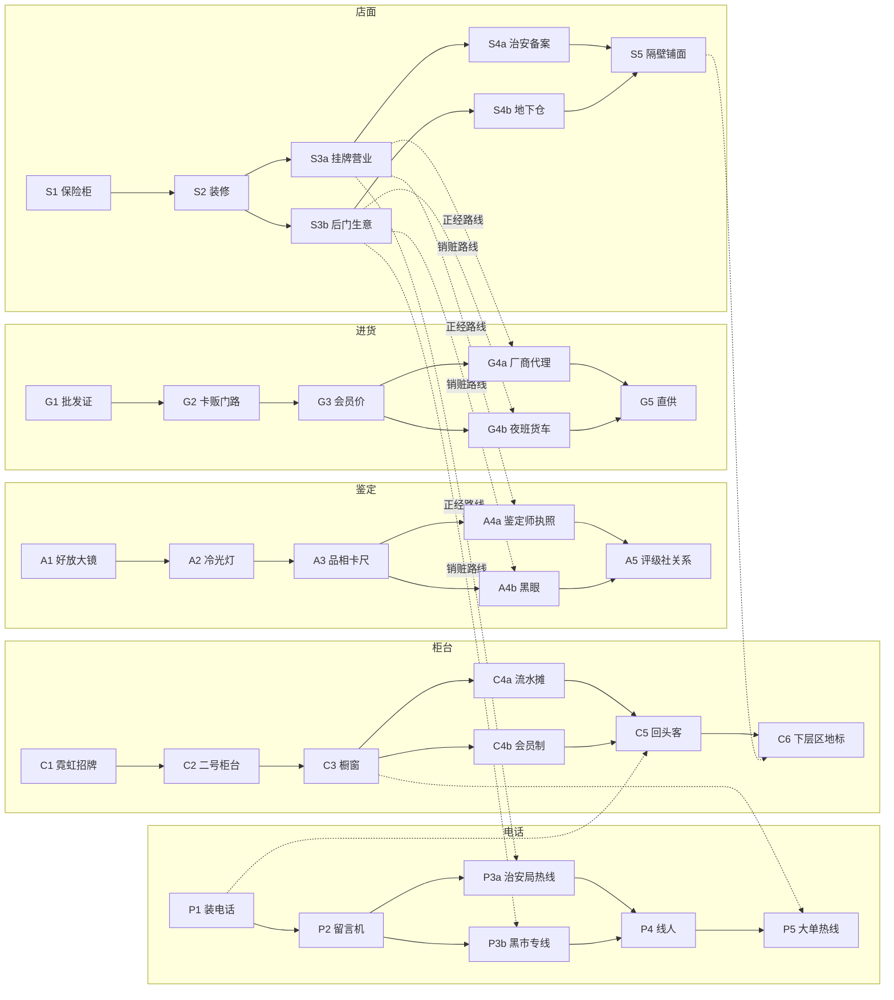

# 卡奴：科技树 v1（店铺升级）

> 版本 2026-11-17，草案。数值全部是**初值，待模拟脚本验证**，定稿后进 `packages/shared/src/balance.ts`（`TECH_TREE` 一张表），不在别处写死。
> 规则和经济口径以 [DESIGN.md](DESIGN.md) 为准；本文件定稿后再合进 DESIGN 和 SRS。

## 0. 一页总结

| 项目 | v1 |
| --- | --- |
| 分支 | 5 条：柜台、鉴定、进货、电话、店面 |
| 层数 | 1–6 层；柜台到第 6 层，其余到第 5 层 |
| 节点数 | 32 个（其中 6 组"二选一"，一个玩家最多点 26 个） |
| 整棵树总价 | 346,500 信用点；只走一条路线点满约 280,000 |
| 保守玩家一个赛季 | 约 23,000 进树，8–10 个节点，最深到第 3 层；科技树永久保留，之后的赛季接着点 |
| 冒险玩家一个赛季 | 约 100,000 进树，15–18 个节点，一两条分支到第 5 层 |
| 核心抉择 | 店面第 3 层选路线：**挂牌营业（正经店）**或**后门生意（销赃窝点）**，鉴定、进货、电话的第 3–4 层跟着路线走 |

一句话：科技树是新经济的主要信用点回收口，也是"开成什么样的店"的身份系统。点不满是故意的。

**已定规则（2026-11-17 用户拍板）**：

1. 科技树永久保留，赛季末不清空（2026-11-17 从"赛季末重置"改成软赛季，见 DESIGN 10.5）。
2. 破产保留已点的节点。
3. 节点除了信用点，还有前置条件：信誉门槛和里程碑（见 3.0）。
4. 科技树完全不和派系挂钩：不用派系关系做解锁条件，节点效果也不加减派系关系，不替代派系系统。正经店 vs 销赃窝点的路线用信誉和里程碑来表达。

## 1. 借鉴了哪些游戏

| 类型 | 代表 | 结构 | 优点 | 缺点 | 我们借鉴 | 不借鉴 |
| --- | --- | --- | --- | --- | --- | --- |
| 时代分层的有向图 | 文明系列 | 按时代分层，节点有多个前置（同时满足） | 好规划，玩家看得懂"下一步要什么" | 最优路线固定，大家点法趋同 | 分层 + 跨分支前置 | 全树能点满（我们赛季内点不满） |
| 大型被动网 | 流放之路 | 几百个小节点 + 少量"关键节点"，从不同起点出发 | 流派多样 | 新手劝退，平衡难 | 小数值节点 + 每支末端一个效果明显的大节点 | 规模（手机竖屏放不下） |
| 产线解锁 | Factorio、戴森球计划 | 研究解锁的是新机器、新玩法，不只是加数值 | 每次解锁都有新东西可玩 | 内容量大 | 很多节点解锁**新系统**：卡贩、黑市卡包、电话来电、橱窗 | 资源产线本身 |
| 每档二选一 | Hades 的冥镜 | 每格有两个版本，二选一，可以随时免费换 | 每次构筑都有取舍 | 免费切换后取舍变轻 | 二选一互斥 | 随时免费换（我们要路线承诺，改要付代价） |
| 局外成长 | 多数 Rogue 游戏 | 跨局永久积累 | 有长期目标 | 老玩家碾压新人 | 借鉴：软赛季下科技树**永久积累**；新人在赛季积分上和老玩家同一起跑线（只算本季新拿的分） | — |
| 店铺等级 | Recettear | 店铺升级扩柜台、换装修，吸引更有钱的客人 | 升级直接改变客群 | 线性 | 店铺升级改变顾客类型的权重（精品店 vs 流水摊） | 纯线性 |
| 向镇上投资 | Moonlighter | 花钱给镇上 NPC 开铺子、扩店，带来更多客流 | 钱有去处，扩店有成就感 | 后期钱没处花 | 扩店 = 更多顾客，花钱换客流是回收口 | — |
| 执照 + 等级双门槛 | Supermarket Simulator | 执照要店铺等级和现金同时满足 | 防止有钱就一口气点完 | 等级门槛太陡时卡人 | 部分节点要求信誉或里程碑 | 陡峭的等级墙 |
| 天赋点 | Potion Craft | 用经验换天赋点，多是小加成 | 简单 | 加成太小没感觉 | — | 单独的天赋点货币（我们直接用信用点，才能当回收口） |
| 联系人卖升级 | 《深空当铺：可能是偷的》（Probably Stolen） | 升级从不同 NPC 联系人那里买（网络升级、设备升级各有一位）；店里有电话可以订货 | 升级有人情味，题材感强 | 联系人多了玩家记不住 | 每条分支挂一位下层区联系人当"卖家"；电话作为一条独立分支 | 照搬它的联系人、物品和剧情 |

**每条分支的联系人**（原创角色，只用于文案和界面）：

| 分支 | 联系人 | 一句话 |
| --- | --- | --- |
| 柜台 | 招牌匠阿灯 | 下层区一半的霓虹灯是她接的线 |
| 鉴定 | 退休鉴定师眼镜婆 | 上层区评级社出来的，没人知道她为什么下来 |
| 进货 | 货郎七号 | 物流站的搬运机器人，自称有"第七个仓库" |
| 电话 | 接线员零号台 | 整条街的电话都从她的交换机过 |
| 店面 | 房东塔姆先生 | 收租准时，其他事一概不问 |

## 2. 分支说明

我们保留了提案里的五条分支，没有合并：

- **柜台**：直接加客流，是保守路线收益最高的一支（因为卖卡的瓶颈就是每天只有 6 位顾客）。
- **鉴定**：降低鉴定成本、提高准确率，吸收了原 DESIGN 的"鉴定师执照"。
- **进货**：加限购、打折，解锁卡贩和黑市卡包。
- **电话**：一个事件系统，见第 5 节。
- **店面**：负责选路线，以及抵押、藏匿室、扩店这类"店本身"的东西。

**路线选择放在店面分支**：店面第 3 层二选一"挂牌营业 / 后门生意"，之后鉴定、进货、电话各有一组路线专属节点，前置要求对应的路线。这样一次选择就决定了整家店的风格，不用玩家在四个地方分别选。

另有一组独立于路线的二选一：柜台第 4 层的"流水摊 / 会员制"。正经店也可以走流水，销赃窝点也可以做精品。

## 3. 节点表

**价格按层级**：第 1 层 1,500–2,000，第 2 层 4,000–6,000，第 3 层 7,000–8,000，第 4 层 12,000–14,000，第 5 层 18,000–24,000，第 6 层 45,000。

**规则**：一个节点的前置写着"A + B"时，A 和 B 都要点过。"任一"表示二选一里点了哪个都行。"二选一"的两个节点同一个玩家只能点一个。

### 3.0 解锁条件

每个节点要同时满足三样：**前置节点、信用点、额外条件**。第 1 层没有额外条件，开局就能点；第 2 层起每个节点至少有一条。

**额外条件只有两种**：

1. **信誉门槛**：信誉 0–100，开局 50（DESIGN 6）。只在购买那一刻检查，点了之后信誉再掉也不会失去节点。
2. **里程碑**：服务器记的累计计数，永久有效，破产和赛季结束都不清零。玩家在科技树界面能看到每项的当前进度（"送评 7 / 10"）。

| 里程碑 | 怎么算 | 保守玩家大约多久达到 |
| --- | --- | --- |
| 成交笔数 | 卖给 NPC 顾客成交一次算一笔（被识破退款的不算） | 每周约 42 笔 |
| 接待顾客 | 顾客到柜台、玩家开过价就算（不管成没成） | 每周约 42–50 位 |
| 开包数 | 开正规卡包，一包算一次 | 每周约 14 包 |
| 放大镜次数 | 看真伪、看品相各算一次 | 看玩法，每周约 10–20 次 |
| 验真张数 | 送鉴定机构出了结果（不管真假） | 看玩法 |
| 送评张数 | 送评社出了结果（含拒评） | 看玩法 |
| 高分封壳 | 自己送评出 9 分以上（含黑标）的张数 | 稀有，一赛季几张 |
| 卖出封壳卡 | 卖给 NPC 的封壳卡张数 | 看玩法 |
| 中间人成交 | 卖给黑市中间人成交的次数 | 看玩法 |
| 卡贩收卡 | 从卡贩手里买下卡的次数 | 点了 G2 才有 |
| 接电话 | 接起来电的次数（推销电话也算） | 每周约 7–14 通 |
| 预约完成 | 预约客来了并且成交 | 看运气 |
| 按时交租 | 周日扣租时余额够、没进宽限期的次数 | 每周 1 次 |

**设计原则**：

- 里程碑都是**玩家自己做过的事**，不会泄露隐藏属性。例如没有"卖出假卡没被识破"这种计数，因为计数一涨，玩家就知道那张卡是假的。
- 正经路线的门槛是**高信誉 + 正经事做得多**（验真、按时交租、成交量）；销赃路线的门槛是**和黑市打交道的次数**（中间人成交、卡贩收卡）。两条路线都不用派系关系。
- 门槛按保守玩家的节奏排：第 2 层大约第 1 周能满足，第 3 层第 2 周，第 4 层第 3–4 周，第 5 层第 5 周以后，第 6 层要玩得很好。

### 3.1 柜台（C）

| 编号 | 名称 | 层 | 前置 | 价格 | 额外条件 | 效果 | 文案 |
| --- | --- | --- | --- | --- | --- | --- | --- |
| C1 | 霓虹招牌 | 1 | — | 1,500 | — | 所有顾客耐心 +1 | "灯一亮，人就不急着走。" |
| C2 | 二号柜台 | 2 | C1 | 6,000 | 成交 10 笔 | 每天顾客 6 → 7（晚市 +1） | "多一张台面，多一个冤大头。" |
| C3 | 橱窗 | 3 | C2 | 8,000 | 成交 30 笔 | 2 个橱窗格：放进去的卡每天有 30% 概率以公开价 70% 自动卖出（每格每天最多 1 张） | "玻璃后面的卡，看着就比手里的值钱。" |
| C4a | 流水摊（二选一） | 4 | C3 | 12,000 | 成交 80 笔 | 每天顾客 +2；居民权重 ×1.5 | "薄利多销，下层区讲的是量。" |
| C4b | 会员制（二选一） | 4 | C3 | 12,000 | 信誉 ≥ 60，卖出封壳卡 3 张 | 收藏家、富人权重 ×1.5，居民权重 ×0.5；顾客数不变 | "没卡的别进来。" |
| C5 | 回头客 | 5 | C4 任一 + P1 | 18,000 | 接待顾客 150 位 | 当天谈崩走掉的顾客，30% 第二天再来，耐心回满，心理价位不变 | "他还是想要那张卡。" |
| C6 | 下层区地标 | 6 | C5 + S5 | 45,000 | 已买下店铺，信誉 ≥ 70，高分封壳 3 张 | 大藏家（珍藏柜引来的高级顾客，DESIGN 8.1）上门几率翻倍，上限也翻倍；大藏家成交开播报（2026-11-17 改：原来"每周日来一位上层区大藏家"和珍藏柜的大藏家重复） | "整条街都知道，好卡要往你这儿送。" |

### 3.2 鉴定（A）

| 编号 | 名称 | 层 | 前置 | 价格 | 额外条件 | 效果 | 文案 |
| --- | --- | --- | --- | --- | --- | --- | --- |
| A1 | 好放大镜 | 1 | — | 1,500 | — | 放大镜费用 −30%（看真伪、看品相都算） | "镜片是从报废的轨道望远镜上拆的。" |
| A2 | 冷光灯 | 2 | A1 | 4,000 | 放大镜 10 次 | 放大镜看真伪，高仿识别率 60% → 75% | "冷光下，高仿的油墨会发灰。" |
| A3 | 品相卡尺 | 3 | A2 | 7,000 | 放大镜 30 次，送评 3 张 | 放大镜看品相从"相邻两档"变成**一个估计分**：80% 是真实分，20% 偏 1 分。仍只是估计，不改任何报价 | "眼镜婆说：尺子不会骗人，但会看错。" |
| A4a | 鉴定师执照（正经） | 4 | A3 + S3a | 12,000 | 信誉 ≥ 60，验真 10 张 | 鉴定机构费用 −50%，出结果 24 小时 → 6 小时；第三阶段起可以给别的玩家代鉴定收费 | "盖了评级社钢印的证，下层区没几张。" |
| A4b | 黑眼（销赃） | 4 | A3 + S3b | 12,000 | 中间人成交 10 次，放大镜 50 次 | 放大镜看真伪，高仿识别率 → 90%；还会给一句来源提示（"闻着像登记表上的"），70% 准 | "她不看证书，只看手。" |
| A5 | 评级社关系 | 5 | A4 任一 | 20,000 | 送评 15 张，高分封壳 1 张 | 送评费 −40%；可以加急：付 2 倍评级费，2 小时出分 | "排队？那是给别人准备的。" |

### 3.3 进货（G）

| 编号 | 名称 | 层 | 前置 | 价格 | 额外条件 | 效果 | 文案 |
| --- | --- | --- | --- | --- | --- | --- | --- |
| G1 | 批发证 | 1 | — | 1,500 | — | 正规卡包每日限购 5 → 6 | "七号说：一张证，多一箱。" |
| G2 | 卡贩门路 | 2 | G1 | 4,000 | 成交 15 笔 | 解锁卡贩顾客（柜台收卡，DESIGN 4），出现概率 18%（2026-11-17 用户定：从第 3 层挪到第 2 层、10% → 18%；没点这个节点就不会有卡贩） | "有人急着出手，就有人收。" |
| G3 | 会员价 | 3 | G2 | 7,000 | 开包 40 包 | 正规卡包 9 折（300 → 270） | "老客户，抹个零。" |
| G4a | 厂商代理（正经） | 4 | G3 + S3a | 12,000 | 信誉 ≥ 60，开包 70 包，按时交租 3 次 | 每周一个预购箱：3 包正规卡包 + 1 张保证 SR 以上，售价 1,200；新系列提前 1 天开卖 | "出厂封条，一箱一码。" |
| G4b | 夜班货车（销赃） | 4 | G3 + S3b | 12,000 | 卡贩收卡 5 次，中间人成交 10 次 | 每周三、周六各来一辆货车：可以按公开价 × 35% 整箱买 8 张全未知的卡（每张 30% 假卡、40% 赃物），不买就开走 | "车牌是手写的。" |
| G5 | 直供 | 5 | G4 任一 | 22,000 | 开包 120 包 | 正规卡包每日限购再 +2；正规保底 10 包 → 8 包 | "货从出厂直接到你柜台。" |

黑市卡包的解锁条件保持 DESIGN 原样（派系），科技树不碰。G4b 是一条独立于黑市卡包的进货渠道。

### 3.4 电话（P）

2026-11-17 改：电话从"别人打进来"改成**订货线**——装了电话才能向批发商整盒订卡包（一盒 10 包、每包 8 折、马上到货，但批发商不保证正品，每张约 5% 是假卡，见 DESIGN 第 4 节）。原来的来电（预约客、治安局、黑市、线人、委托）并进 DESIGN 8.6 的**特殊事件系统**，由下面的节点解锁对应的事件池。

| 编号 | 名称 | 层 | 前置 | 价格 | 额外条件 | 效果 | 文案 |
| --- | --- | --- | --- | --- | --- | --- | --- |
| P1 | 装电话 | 1 | — | 2,000 | — | 解锁电话批发：5 种卡包整盒订，每个营业日只能订一次、一次一盒（用户 2026-11-17 定，科技树不加次数） | "零号台：线接好了，批发商的号码都在这本册子里。" |
| P2 | 熟客价 | 2 | P1 | 4,000 | 批发 5 盒 | 批发价 8 折 → 7 折（订货次数和盒数不变） | "订得多了，零号台给你转的都是好说话的批发商。" |
| P3a | 正规批发商（正经） | 3 | P2 + S3a | 8,000 | 信誉 ≥ 60，批发 15 盒 | 批发盒假卡率 5% → 1%；解锁"治安局"事件池（协查、举报奖金） | "有执照的批发商，贵是贵点，货干净。" |
| P3b | 黑市专线（销赃） | 3 | P2 + S3b | 8,000 | 中间人成交 8 次，批发 15 盒 | 批发再便宜 1 折，但假卡率 5% → 15%、每张 5% 是赃物；解锁"黑市"事件池（甩货、收货） | "这个号码不在任何电话簿上。" |
| P4 | 线人 | 4 | P3 任一 | 12,000 | 批发 30 盒 | 解锁"线人"事件池：提前收到明天的空间站日报，20% 是假消息（依赖第二阶段的新闻系统） | "消息比日报早半天，真不真自己判断。" |
| P5 | 大单热线 | 5 | P4 + C3 | 20,000 | 批发 50 盒，完成委托 5 次 | 解锁"委托"事件池：有人点名要货，开价不看市价，每周最多 1 次 | "有人点名要货，开价不看市价。" |

柜台分支（3.1）的客流节点按营业日算（每个营业日 6 → 7 → 9 位）；另外 C1、C3、C6 顺带提高特殊事件的触发概率（具体数字等事件系统做出来再定）。

### 3.5 店面（S）

| 编号 | 名称 | 层 | 前置 | 价格 | 额外条件 | 效果 | 文案 |
| --- | --- | --- | --- | --- | --- | --- | --- |
| S1 | 保险柜 | 1 | — | 1,500 | — | 珍藏柜额外 +2 格（和用品店买的等级叠加，2026-11-17 改）；抵押折算 50% → 55% | "塔姆先生对有保险柜的租客客气一点。" |
| S2 | 装修 | 2 | S1 | 5,000 | 按时交租 1 次 | 信誉每周自动 +2（最高到 80） | "墙刷白了，客人也敢多待一会儿。" |
| S3a | 挂牌营业（路线二选一） | 3 | S2 + 任一分支的第 2 层 | 8,000 | 信誉 ≥ 55，成交 30 笔 | 正经店：治安巡查抽中概率 10% → 5%；卖真卡给 NPC 信誉 +1（每天最多 +3） | "牌子挂出去，就得守规矩。" |
| S3b | 后门生意（路线二选一） | 3 | S2 + 任一分支的第 2 层 | 8,000 | 中间人成交 5 次 | 销赃窝点：解锁藏匿室 3 格（里面的赃卡被巡查查出 70% → 20%）；中间人出价 40% → 50% 基准价 | "后门不挂牌，熟人敲三下。" |
| S4a | 治安备案（正经） | 4 | S3a | 14,000 | 信誉 ≥ 65，按时交租 3 次，验真 5 张 | 每周第一次被查出赃卡（比如从卡贩那里收来的）只没收，不罚款、不扣信誉 | "备过案的店，治安局给一次面子。" |
| S4b | 地下仓（销赃） | 4 | S3b | 14,000 | 中间人成交 15 次 | 藏匿室 3 → 6 格，查出率 20% → 10% | "地板下面还有一层地板。" |
| S5 | 隔壁铺面 | 5 | S4 任一 | 24,000 | 已买下店铺 | 每个时段顾客 +1（每天 +3）；橱窗格 +2（要先点 C3） | "塔姆先生把隔壁也租给你了。" |

**路线的门槛怎么拉开**：正经路线（S3a 和各分支的 a 节点）都要求信誉 55–65 以上，再加验真、按时交租、成交量这类"正经事"；销赃路线（S3b 和各分支的 b 节点）不看信誉，看的是和黑市打交道的次数（中间人成交、卡贩收卡）。一个玩家可以两边的里程碑都攒，但 S3 只能二选一。

## 4. 树的结构

实线是本分支的前置，虚线是跨分支前置。同一层里带 a / b 的两个节点二选一。

## 5. 电话：来电事件系统

> 2026-11-17：这一节是旧设计，保留作为事件内容的素材。电话已改成订货线（见 3.4），下面的来电类型改成 DESIGN 8.6 特殊事件系统里的事件池，由配置文件定义，不再单独做一套来电机制。

### 5.1 怎么来电

- 每天第一次打开 Activity 时，服务器按当天已解锁的来电类型，抽好今天的来电（时间点在悉尼 08:00–22:00 之间随机），存库，之后不再变。和柜台顾客一样按需生成，不靠定时任务。
- 每天上限：P1 是 1 通，P2 是 2 通。房东来电另算，不占名额。
- 来电时 Activity 里电话图标响。不在线的话，P2 之前 2 小时后过期，P2 之后保留到当天结束。电话不发 Discord 私信（私信只留给催租和破产）。
- 所有来电的数值和结果由服务器决定，台词从可编辑的 JSON 台词表抽，和顾客台词同一套做法。

### 5.2 来电类型

| 来电 | 解锁 | 权重 | 内容 | 接了 | 不接 |
| --- | --- | --- | --- | --- | --- |
| 预约客 | P1 | 35 | "明天午市有位收藏家想看火属性 SR 以上" | 明天对应时段多来一位指定需求的顾客（不占名额），耐心 +1，心理价位 ×1.15 | 什么都不发生 |
| 回电 | P1 | 25 | 昨天谈崩的顾客打来 | 卡还在库存的话，可以按他上次的还价在电话里直接成交 | 这位顾客彻底没了 |
| 推销电话 | P1 | 10 | "恭喜中奖，交 500 手续费领空间站度假券" | 付了就亏 500，什么也拿不到；拒绝什么都不发生。台词里留破绽，教玩家看话术 | 什么都不发生 |
| 房东 | P1，宽限期开始时必响 | — | 塔姆先生催租 | 每赛季可以申请一次宽限期延长 12 小时 | 宽限期照常 |
| 治安局协查 | P3a | 20 | "最近有人报失一批《霓虹龙·影》" | 可以把库存里这个模板的一张卡交去核查，1 天后出结果：是赃物给奖金（公开价 × 30%），信誉 +3；不是赃物就退回，并打上公开的"来源清白"标记 | 什么都不发生 |
| 黑市甩货 | P3b | 20 | "有一批货，要不要" | 可以按公开价 × 40% 买 3 张全未知的卡（每张 30% 假卡、40% 赃物） | 什么都不发生 |
| 黑市收货 | P3b | 15 | "手上有没鉴定的货吗" | 收最多 3 张未鉴定卡，每张给基准价 45%（比柜台的中间人高 5 个点） | 什么都不发生 |
| 线人 | P4 | 15 | 明天的日报提前到 | 提前半天知道明天的新闻，20% 是假的 | 明天照常看日报 |
| 委托 | P5 | 每周固定 1 次 | 点名要某个模板或某个标签，带品相要求（比如封壳 8 分以上），3 天期限 | 期限内交上：成交价 = 公开价 × 2；接了没交上信誉 −2 | 什么都不发生 |

隐藏属性的约束：
- 治安局协查**不点名玩家手里的哪一张是赃物**，只报模板名，所以来电本身不泄露任何卡的来源。
- 交去核查是玩家主动做的一次付时间的鉴定，结果只对那一张卡，存库后不再变。

## 6. 经济对账

**以下全是初值，待模拟脚本验证。**

### 6.1 一个赛季的钱够点多少

保守路线：只开正规包，每天 2 包，交租前每周中位约 +9,500（`npm run sim`）。

| 玩家 | 赛季进账（交租前） | 交租 + 买店 | 能进树的钱 | 大约点到 |
| --- | --- | --- | --- | --- |
| 保守，第 4–5 周买店 | 约 76,000（模拟中位每周约 9,500 × 8）+ 开局 1,500 | 交租约 21,000（1–4 周）+ 买店 31,000 | 约 23,000（2026-11-17 按 `npm run sim` 中位粗估） | 8–10 个节点，最深第 3 层 |
| 保守，不买店 | 约 96,500 | 交租 8 周约 49,300 | 约 47,000 | 10–12 个节点，但第 7、8 周很吃紧 |
| 冒险（黑市 + 送评） | 约 150,000–200,000 | 同上 | 约 100,000 | 15–18 个节点，一两条分支到第 5 层 |

所以 C6 这类第 6 层节点和 S5（要先买店）是给玩得最好的人准备的。大部分人一个赛季点不到，但科技树跨赛季保留（软赛季），第二、三个赛季能接着点。

### 6.2 收入型节点的回本速度

| 节点 | 每周多赚 | 回本 |
| --- | --- | --- |
| C2 二号柜台 | 每周多 7 位顾客 × 约 380 ≈ 2,700 | 约 2.2 周 |
| C4a 流水摊 | 每周多 14 位顾客，居民多、单价低，约 3,500 | 约 3.4 周 |
| S5 隔壁铺面 | 每周多 21 位顾客，约 8,000 | 约 3 周（前提是已经花了 31,000 买店） |
| G2 会员价 | 每天 2 包时每周省 420；每天 5 包时省 1,050 | 9.5 周 / 3.8 周：只对开包多的人划算 |

**预期的打法**：先点 C1、C2 这类加客流的节点，再买店，再点 S5。这和"先买店图安心、还是先滚雪球"的原有取舍是一致的。模拟脚本要专门跑"先点树后买店"和"先买店后点树"两种策略，看差距是否合理。

**风险**：柜台分支回本最快，可能人人都先点柜台。如果模拟显示太集中，就把 C2 的价格提高，或者给鉴定、进货的第 2 层加一点收入效果。

## 7. 规则

| 规则 | 推荐 | 理由 |
| --- | --- | --- |
| 赛季末 | **不清空**（2026-11-17 改）：节点、蓝图、里程碑计数都永久保留 | 软赛季下卡、信用点、店铺都不清空，科技树跟着一致；以后每个赛季加新节点，给老玩家新目标 |
| 货币：蓝图 | **节点用"蓝图"买，不直接花信用点**（已定）。信用点按 1 : 1 单向换成蓝图（比例放 balance.ts），蓝图不能换回信用点、不能兑金币、不能在玩家之间转。上表的价格都按蓝图计 | 蓝图和信用点分开，"改换门庭"才能做到全额退回而不变成提现口子 |
| 租金保证金 | 换蓝图和兑金币都只能动**超过下次租金的那部分信用点** | 防故意破产（见下一行），2026-11-17 模拟验证过 |
| 破产 | **保留已点的节点和手上的蓝图**（已定），里程碑计数也保留，效果立刻照常生效 | 从头开始已经清空了信用点、珍藏柜以外的卡和店铺，再拿走店铺升级太狠。故意破产的问题由"租金保证金"和 DESIGN 第 7 节的破产规则处理，不动科技树 |
| 洗点：改换门庭 | **每赛季可以用信用点买一次"改换门庭"**（已定，初值 15,000 信用点）：所有节点清空，花掉的蓝图**全部退回**，可以按新路线重新点。里程碑计数不受影响 | 路线要有承诺感，但给一次后悔机会；退的是蓝图不是信用点，所以不能借此把钱从科技树里取出来兑金币 |
| 购买 | 服务器校验前置、互斥和额外条件，在一个事务里扣钱、加节点、写 events_log，带幂等 key | 和其他写操作一样 |
| 展示 | 每个节点的效果以"当前值 → 点了之后的值"展示 | 新手看得懂 |

## 8. 隐藏属性的约束

- 所有报价（橱窗卖价、电话收货价、委托价）都用公开价算（SRS FR-APPR-5），不读真实品相、真伪或来源。
- A3 品相卡尺、A4b 黑眼给的都是**带误差的估计**，每张卡只估一次，结果存库，之后一直显示同一个结论。
- 改顾客权重的节点（C4a、C4b）只影响抽到哪类顾客，不改变心理价位的算法，也不向玩家显示任何顾客的心理价位。
- 每个改了卡牌或顾客接口的节点，都要有测试断言响应里没有隐藏属性（CLAUDE.md 第 2 条）。

## 9. 对路线图的影响

| 原系统（DESIGN） | 处理 |
| --- | --- |
| 鉴定师执照（DESIGN 5.3） | **吸收**：A4a 鉴定师执照 |
| 藏匿室（DESIGN 8.3） | **吸收**：S3b 后门生意、S4b 地下仓。藏匿室本身改由科技树解锁。DESIGN 8.4 黑市派系的盟友奖励里的"藏匿室"换成"失窃登记表副本"（每周查 3 张卡在不在登记表上，查到不没收、不公开），已同步到 DESIGN |
| 卡贩、柜台收卡 | **吸收**：G2 卡贩门路 |
| 买店后"扩店" | **吸收**：S5 隔壁铺面、C6 下层区地标 |
| 派系（DESIGN 8.4）：正规商会、黑市、收藏家协会、治安关系 | **不动**。科技树不读派系关系，也不改派系关系。派系原有的奖励（9 折、限购 +2、黑市专属卡包、高价收卡委托等）照旧由派系给，和科技树的同类效果叠加；叠加后的上限放 balance.ts，由模拟脚本核对 |
| 黑市卡包及其解锁条件 | **不动**，仍按 DESIGN 由派系解锁 |

**分阶段上线**：

| 阶段 | 节点 |
| --- | --- |
| MVP（第一阶段） | C1 霓虹招牌、C2 二号柜台、A1 好放大镜、G1 批发证、S1 保险柜、P1 装电话（只开预约客、回电、房东三种来电）：6 个，总价 14,000 |
| 第二阶段（风险与抓捕） | 路线选择 S3a / S3b 以及各分支的路线节点、G2 卡贩门路、P4 线人（新闻系统同时上） |
| 第三阶段（多人） | A4a 的代鉴定、S5、C6、P5 |

## 10. 给开发的备注

- `balance.ts` 里一张 `TECH_TREE` 表：`id`、`branch`、`tier`、`requires`（数组，全部满足）、`exclusiveWith`、`price`、`conditions`、`effects`（结构化，比如 `{ kind: 'customersPerDay', delta: 1 }`）。效果由 `game/` 里的纯函数读表计算，不在路由里写 if。
- 建议新表：`tech_owned`（discord_id、node_id、season_id、bought_at）、`phone_calls`（id、owner_id、sydney_day、kind、payload JSON、rings_at、expires_at、status）、`tech_counters`（discord_id、season_id、counter、value；counter 是 3.0 表里的 13 项里程碑，在对应操作的同一个事务里 +1）。
- 新接口：`GET /api/tech`（树 + 自己的状态）、`POST /api/tech/buy` `{ nodeId }`、`GET /api/phone`、`POST /api/phone/:id/answer` `{ choice }`。都按 SRS 6.1 带幂等 key。

## 参考

- [Probably Stolen 新手攻略（KeenGamer）](https://www.keengamer.com/articles/guides/probably-stolen-complete-walkthrough-beginner-tips/)
- [Probably Stolen 前期升级（games.gg）](https://games.gg/probably-stolen-cyberpunk-shopkeeper-sim/guides/probably-stolen-best-early-upgrades/)
- [tinyBuild 发布 Probably Stolen（GamesBeat）](https://gamesbeat.com/tinybuild-unveils-probably-stolen-a-cyberbunk-shop-simulator-where-the-goods-arent-legal/)
- [Hades 冥镜（Fextralife Wiki）](https://hades.wiki.fextralife.com/Mirror+of+the+Night)
- [Hades 局外成长机制整理](https://saschb2b.github.io/game-mechanics/games/hades/meta-progression)
- [Supermarket Simulator 新手技巧（Common Sense Gamer）](https://commonsensegamer.com/supermarket-simulator-tips-amp-tricks-for-beginners-hcfe/)
- 文明系列、流放之路、Factorio、戴森球计划、Recettear、Moonlighter、Potion Craft 的结构描述来自通用资料，未逐条检索。
